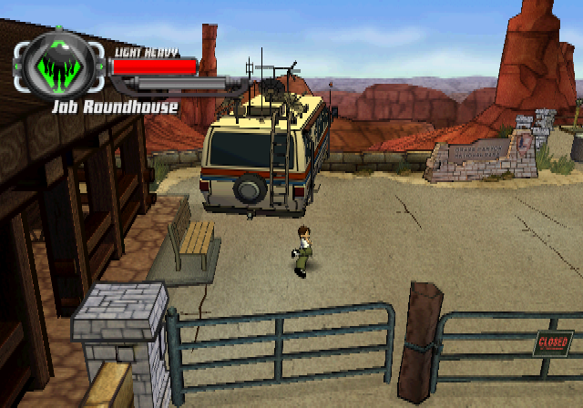
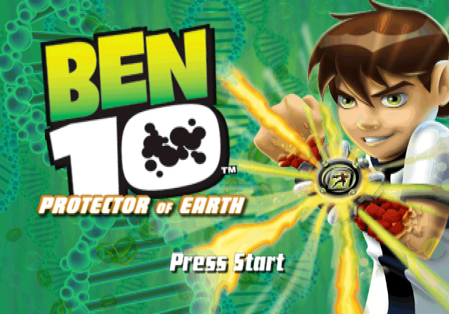
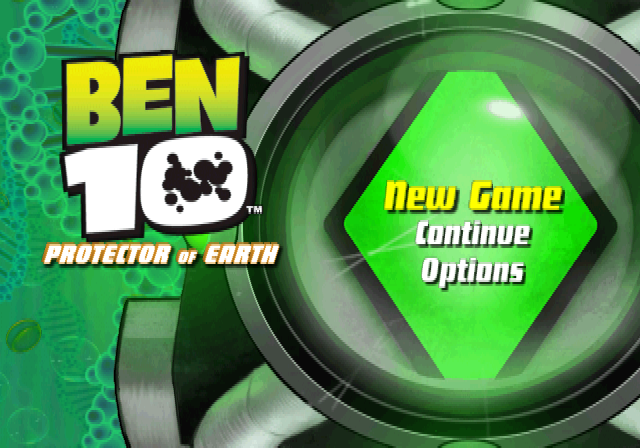

<div align="center">

# Protector of Earth Recomp

**An unofficial native PC port of *Ben 10: Protector of Earth***<br>
<sub>PlayStation 2 · 2007 · High Voltage Software: statically recompiled, then rebuilt piece by piece with native code</sub>

<br>


**[About](#-about)** · **[Screenshots](#-screenshots)** · **[Going native](#-going-native)** · **[Building](#%EF%B8%8F-building)** · **[Documentation](#-documentation)** · **[Contributing](#-contributing)**


<sub>Sebatime</sub>

</div>

<br>

> [!WARNING]
> **Not playable yet.** The game's code is translated to C++, compiles in full and runs up to its menus and the loading of the first level. See the milestones below.

> [!IMPORTANT]
> **No game files are included.** You need your own disc of *Ben 10: Protector of Earth* (PS2, **USA**, SLUS-21661) dumped to an `.iso`. The game is built on your computer from it.

## 📖 About

*Ben 10: Protector of Earth* came out on PlayStation 2, PSP and Wii, but never on PC. **Protector of Earth Recomp** aims to preserve it as a real PC game.

It isn't an emulator: the PS2 program is [translated into C++ ahead of time](docs/02-how-the-port-works.md) by [PS2Recomp](https://github.com/ran-j/PS2Recomp) and built as a native Windows or Linux program. The parts that still pretend to be a PS2 (the I/O processor, the vector units, the graphics chip, the sound) are then replaced, one by one, with the port's own code.

The project follows the organisation of [Mind over Recomp](https://github.com/Maxilure/MindOver-Recomp): everything learned about the game becomes a note in [docs/findings/](docs/findings/README.md).

## 📸 Screenshots

<div align="center">

<br>
<sub>Ben attacking in the first level, drawn by the port on Linux (<a href="docs/findings/20-vu1-census-and-gs-thread.md">findings/20</a> s.9).</sub>

 <br>
<sub>The title screen and the main menu, drawn by the port on Linux (<a href="docs/findings/18-memory-card-and-menus.md">findings/18</a>). More in <a href="docs/images/screenshots/README.md">docs/images/screenshots/</a>.</sub>

</div>

<sub>Screenshots show content from *Ben 10: Protector of Earth* (High Voltage Software / D3 Publisher, 2007; *Ben 10* is a trademark of Cartoon Network). It is their work, not this project's or its maintainer's; see [docs/images/screenshots/](docs/images/screenshots/README.md).</sub>

## 🧩 Going native

The game's code is already translated to C++. What is still emulated is the **PS2 around it**: each piece the port answers with its own code is one less piece of pretend PS2.

<!-- native-progress:begin -->
<!-- Written by tools/native_progress.py --readme: edit the tool, not this block. -->

| Milestone | | Status |
|---|---|---|
| Executable analysis | ✅ | 4,420 functions; the script API table (findings/09-12) |
| Translation to C++ | ✅ | 0 unsupported instructions (findings/13) |
| Full build | ✅ | the generated C++ + runtime compile and link on Linux (findings/14) and Windows, MSVC Release (findings/19 s.1) |
| Per-instruction tests | 🔧 | 38 end-to-end tests; translator bugs found and fixed: 4 (findings/14), then VF0 writes, 5 MMI permutes and the VU0 macro memory ops (findings/18 s.11-12) |
| Boot | ✅ | loads the 8 IOP modules and its data, runs past 3,000 frames once the runtime's own data left the game's heap (findings/15 s.15) |
| First frame | ✅ | the memory card warning, drawn by the game under Xvfb, Linux (findings/15 s.16); not compared with PCSX2 yet |
| Main menu | ✅ | memory card found (libmc bound), save created, title screen and main menu (findings/18) |
| Playable level | 🔧 | the first level is playable from the keyboard: walking, combat, the Omnitrix (Heatblast), the first enemies (findings/18-20); about 4.4 fps there (findings/20 s.5, s.8): the VU1 interpreter and the software GS renderer are the limit |

**PS2 pieces replaced by the port's own code: 2 of 27 (7%)** `▰▱▱▱▱▱▱▱▱▱`

| PS2 piece | Replaced | Becomes |
|---|---|---|
| IOP modules | `▰▱▱▱▱▱▱▱▱▱` 1 / 9 | port services answering each request (RPC) of the game, without running the IRX |
| VU microprograms | `▱▱▱▱▱▱▱▱▱▱` 0 / 9 | C++ translated at build time from the .DVP.ovlytab table (findings/11) |
| Graphics (GS) | `▱▱▱▱▱▱▱▱▱▱` 0 / 4 | the port's Vulkan renderer |
| Sound | `▰▰▰▰▰▱▱▱▱▱` 1 / 2 | each audio frame straight to the PC's output |
| Controllers | `▱▱▱▱▱▱▱▱▱▱` 0 / 1 | SDL3: keyboard, mouse and any controller |
| Saves | `▱▱▱▱▱▱▱▱▱▱` 0 / 1 | save files on the PC, no memory card |
| Videos | `▱▱▱▱▱▱▱▱▱▱` 0 / 1 | the PC's video decoder (if the game has MPEG videos) |

Not counted: 42 EE kernel syscalls (threads, semaphores, interrupts), already translated 1:1 by the runtime.
<!-- native-progress:end -->

## 🛠️ Building

The full walkthrough, Windows and Linux, is in **[Building](docs/01-building.md)**. You need CMake 3.21+, Ninja, Python 3, Git, a C++20 compiler (Visual Studio 2022 or GCC 13+/Clang) and, to analyse the executable, Ghidra 12.1 with JDK 21.

<details>
<summary><b>Build commands</b></summary>
<br>

```bash
git clone --recursive https://github.com/zanettevini/ProtectorOfEarth-Recomp.git
cd ProtectorOfEarth-Recomp

# 1. the executable from YOUR disc in game/ (Windows: tools/collect_disc.ps1)
# 2. the function list, from Ghidra (headless)
tools/ghidra_analyze.sh             # Windows: tools/ghidra_analyze.ps1

# 3. configure (applies patches/ps2recomp by itself), translate, build
cmake --preset linux-debug
cmake --build --preset linux-debug --target ben10_codegen
cmake --preset linux-debug          # again: now it finds the generated code
cmake --build --preset linux-debug --target ben10_poe

# tests (no game needed)
cmake --preset linux-tests && cmake --build --preset linux-tests
ctest --preset linux-tests
```

</details>

<details>
<summary><b>Repository layout</b></summary>
<br>

```
ben10_poe.toml           recompiler config: every fix and binding, commented (why + how we found it)
CMakeLists.txt           builds the port (generated code + PS2Recomp runtime + src/)
src/                     the port's own native code
tests/                   automated tests (GoogleTest): EE instructions end to end
tools/                   disc collection, executable analysis, Ghidra, progress board
patches/ps2recomp/       our fixes to PS2Recomp (applied to the submodule by CMake)
docs/                    guides, project status and the findings about the game
thirdparty/PS2Recomp     the recompiler + runtime (git submodule, pinned)

# made on your machine, never committed:
*.iso, game/             your disc and the files taken from it
generated/               the generated C++ and the Ghidra analysis (it is the game's code)
out/, logs/, user/       builds, logs, your local test files
(saves: %APPDATA%\ProtectorOfEarth-Recomp on Windows, ~/.local/share/protectorofearth-recomp on Linux)
```

</details>

## 📚 Documentation

| | |
|---|---|
| 🧠 [How the port works](docs/02-how-the-port-works.md) | static recompilation, explained |
| 🔧 [Building](docs/01-building.md) | every build step, Windows and Linux |
| 📍 [Project status](docs/PROJECT_STATUS.md) | what is done, tested and untested |
| ➡️ [Next task](docs/NEXT_TASK.md) | the next concrete step |
| 🗺️ [Roadmap](docs/DEVELOPMENT_ROADMAP.md) | the project's phases |
| ⚖️ [Decisions](docs/DECISIONS.md) and [Known issues](docs/KNOWN_ISSUES.md) | what was chosen and why; what is missing |
| 🔬 [Findings](docs/findings/README.md) | everything learned about the game and the PS2 |

## 🤝 Contributing

Contributions of any kind are welcome: code, reverse engineering, testing, bug reports, corrections. Before a pull request, read **[CONTRIBUTING.md](CONTRIBUTING.md)**. Working with an AI coding agent? Point it at **[AGENTS.md](AGENTS.md)**: the project's rules for agents (English only, no game data, findings for everything learned, heavy comments, how to test).

> [!NOTE]
> **Developed with extensive AI assistance** (Claude, via Claude Code). The code, reverse-engineering notes and documentation were largely written by the AI; the maintainer sets the direction and reviews the results. Findings are working notes, checked with tools and tests, not by experts: treat them as such and please report errors.

## 💛 Credits

- **[PS2Recomp](https://github.com/ran-j/PS2Recomp)** (ran-j and contributors): the recompiler and runtime this port is built on
- **[PCSX2](https://github.com/PCSX2/pcsx2)**: the PS2 behaviour reference used by the tests
- **[PS2SDK](https://github.com/ps2dev/ps2sdk)**: the open-source SDK used to recognise the Sony library functions in the executable
- **[Mind over Recomp](https://github.com/Maxilure/MindOver-Recomp)** (Maxilure): the model for the organisation, the agent rules and this progress board
- **[Ghidra](https://github.com/NationalSecurityAgency/ghidra)** and **[ghidra-emotionengine-reloaded](https://github.com/chaoticgd/ghidra-emotionengine-reloaded)**: executable analysis
- **Claude** (Anthropic): AI assistant that wrote most of the code and documentation

The full list is in [CREDITS.md](CREDITS.md).

## ⚖️ License and disclaimer

- The code in this repository is licensed under the **[GNU General Public License v3.0](LICENSE)**, the same as PS2Recomp, which it links against.
- The patches in `patches/ps2recomp/` modify PS2Recomp's code and stay under its license (GPL-3.0).

<sub>This is an unofficial fan project for game preservation. It is not affiliated with, endorsed by, or sponsored by D3 Publisher, High Voltage Software, Cartoon Network or Sony. *Ben 10* is a trademark of its respective owners. This repository contains no game code, assets or data: you need your own legally obtained copy of the game.</sub>
