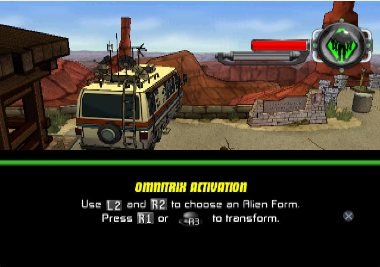

# 19: the first Windows build, and the frame rate

The first build on Windows (MSVC), a frame-rate counter, and the first
speed problem found with it: the EE and the IOP numbered the disc's
sectors differently, so the game's audio streaming module retried a failed
read about 2,000 times a second.

## 1. The Windows build

- Compiler: MSVC 17.14 (Visual Studio 2022 Build Tools), x64, Ninja,
  `CMAKE_BUILD_TYPE=Release` (now the `windows-release` preset). Run from a
  prompt where `vcvars64.bat` has been called.
- Steps: the same as Linux ([01-building](../01-building.md) s.5): configure,
  `ben10_codegen`, configure again, `ben10_poe`. The function list
  (`generated/ghidra/functions.csv`) was copied from the Linux analysis;
  Ghidra on Windows (`tools/ghidra_analyze.ps1`) is still untested.
- Game files: the extracted disc files in `game/`, with `GAME.WAD` copied
  from the mounted `.iso` (Windows mounts it as a drive).
- Time: about 8.5 minutes for the first full build on a desktop
  (about 3.5 of them configuring and applying the patches the first time),
  all 20,235 generated files compiled at `/O2`.
- Result: it links, starts, loads the save from the memory card, and
  reaches the first level and its Omnitrix tutorial in under 75 seconds,
  the same as the Linux build. No Windows-only fix was needed.
- One setup note: `vcvars64.bat` can stop and wait when its output is
  redirected; `VSCMD_SKIP_SENDTELEMETRY=1` and `< nul` avoid it.

*Captured from this port's Windows build. The picture shows the content of
Ben 10: Protector of Earth (High Voltage Software / D3 Publisher; Ben 10 is
a trademark of Cartoon Network); it is not the work of this project. See
[the screenshots README](../images/screenshots/README.md).*

## 2. Measuring the frame rate

`src/diagnostics/frame_rate.cpp` (on only when `BEN10_FPS_LOG` is set)
wraps two of the game's interrupt handlers and prints, about once a
second, `[fps] game frames N in T s, vblanks V`:

- a game frame is counted when the VIF1 DMA end handler (`FUN_0012E670`)
  runs with the "frame kicked" bit (0x08) set in the flags at
  `0x00268540+8`;
- a VBlank is counted by the VBlank handler (`FUN_0012E5F8`).

The first measurements:

| Build | Where | Game frames per second | VBlanks per second |
|---|---|---|---|
| Linux, game code `-O0` (runtime and IOP at `-O2`) | menus | 3 | 3 |
| Windows, MSVC Release | menus and first level | 3-4 | 3-4 |

The game draws one frame per VBlank, so the limit is how fast the virtual
clock runs, not the game waiting. The runtime raises a VBlank when both the
EE cycle count (16,667 µs worth of EE cycles) and the host clock have
passed the deadline (`EeScheduler::processDueDeadlines`); when the host is
behind, the cycle count decides. The generated code counts 32 cycles at
each checkpoint (`eeCheckpointDue(32)`), and each checkpoint also steps the
IOP interpreter by the same time (`advanceIopEeCycles`). So the host time
spent per counted cycle sets the frame rate.

The Linux `-O0` build and the Windows Release build ran at almost the
same speed: the time was not in the game's own (generated) code but in
the runtime and the IOP, which both builds optimise.

## 3. The cause: two disc numberings

Sampling the game thread with gdb (30 stack traces in the menus) put about
a third of the time in the IOP's `sceCdRead` (`IopCdvd::readSectors`), in
its RAM ownership check (`IopMemory::ownsRamRange`) and its zero-filled
buffer. A breakpoint on `readSectors` showed the same request again and
again: LSN 2,046,146, 8 sectors, to IOP address `0x125200`, about 2,000
times a second. The caller was at IOP `0x4F4CC`, inside `CDARB.IRX`
(loaded at `0x4D700`), the game's disc streaming module, which also
serves ALASD's audio streams ([17](17-cdarb-and-alasd.md) s.4).

Every read failed: the IOP's virtual disc, built from `game/`, has
1,200,598 sectors, with `GAME.WAD` at LSN 40. The LSN came from the EE:

- the game asks for `GAME.WAD` with `sceCdSearchFile` on the EE and keeps
  its LSN at `0x002662E8` ([16](16-game-dir-and-wad.md) s.4);
- the EE side of the runtime does not build a disc: it gives each file it
  is asked for a "pseudo" LSN, counting from `0x100000`. So the game saw
  `GAME.WAD` at `0x100000` (1,048,576), as the CDARB trace shows (LSN
  `0x20054F` for WAD sector 1,049,935);
- LSN 2,046,146 = `0x100000` + 997,570: WAD sector 997,570 is inside
  `99_91.pss` (sectors 995,942-998,005), an audio stream, most likely the
  menu music.

The native CDARB reads of the EE ([17](17-cdarb-and-alasd.md) s.7) were not
affected: they turn the LSN into a WAD offset with the saved start LSN, so
any numbering works. The audio streams still go through the interpreted
CDARB in the IOP, which reads by absolute LSN.

## 4. The fix (patch 0012)

- The IOP's `cdvdman` gained a lookup, `IopSubsystem::findCdFile(path)`:
  where its virtual disc puts a file (LSN, size, volume size). It answers
  only for the virtual disc, not when a real disc image is configured.
- The EE's `sceCdSearchFile` asks it (`PS2Runtime::findIopCdFile`) and uses
  the IOP's LSN. Files the IOP does not know keep pseudo LSNs, now
  numbered after the end of the IOP's disc so the two kinds cannot overlap.
- `IopMemory::ownsRamRange` checks the ownership bytes with `memchr`
  instead of a byte loop.
- A ps2xTest case checks the lookup on a small folder; all 451 PS2Recomp
  tests pass.

Result, in the game (Linux): `GAME.WAD` is at LSN 40 on both sides (the
CDARB trace now shows LSN `0x100577` for WAD sector 1,049,935: 40 +
1,049,935), no more repeated reads, and the menus run at **5-6 frames
per second** (from 3).

## 5. What is slow now

The same sampling after the fix: 24 of 30 stack traces are in PS2Recomp's
software GS renderer (`GSCpuBackend`: `DrawTriangle`, `DrawSprite`,
`SampleTexture`, `WritePixel`, the swizzled VRAM reads and writes), called
from the VIF1 DMA on the game thread; 2 are in the IOP interpreter. The
renderer draws every pixel on the CPU, on the same thread as the game, so
the game waits for it each frame.

The way forward is a GPU renderer for the GS (the plan's renderer, behind
the `GSRasterBackend` interface PS2Recomp already has), or, before that, a
faster CPU path (drawing on another thread, fewer per-pixel conversions).
Recorded as KNOWN_ISSUES B13.

## 6. Windows after patch 0012

The `windows-release` build with patch 0012 (8.4 minutes, a full rebuild
because `ps2_runtime.h` changed) runs the title screen at **7 frames per
second** (from 3-4).

## 7. A new stop after "New Game"

On that run, choosing New Game in the main menu stopped the game thread
with a `guest-branch:missing-target` report: an indirect jump (`jr`) at
`0x00185BFC` to `0x00186360`. It was not seen before patch 0012, most
likely because the code that reaches it now runs (to be confirmed).

- `0x00185BFC` is the `jr` of a 158-case switch in `FUN_00185ba0` (bound
  check `sltiu $v0, $a3, 0x9E`, table at `0x0023DAC0`), the twin of the
  switch at `0x00186980` ([18](18-memory-card-and-menus.md) s.6). Before
  the switch, a 3-pass delay loop of `nop`s at `0x00185BC8` branches back.
- The function list has `FUN_00185ba0` (all 146 distinct case targets are
  labels inside it, so its own `jr` resolves) and also a synthetic entry
  `entry_00185bc8` at the loop head, which the recompiler emits as a
  separate function ending at the next entry (`0x00185CD4`).
- Generated code returns to the dispatcher at a backward branch when an EE
  checkpoint is due. Resuming at `0x00185BC8`, the dispatcher picks the
  exact entry, `entry_00185bc8`, whose `jr` can only reach cases inside
  it or cases that are entries; `0x00186360` is neither.
- A scan of the 91 switch tables with this model (the chunk from the
  nearest entry at or before the `jr` to the next one) finds 4 with case
  targets that are unreachable from that chunk: `0x00185BFC` (127
  targets), the script interpreter's `0x00193BF8` (212), `0x001D27D4` (1)
  and `0x001EA13C` (1). The same stop can happen in any of them, whenever
  a checkpoint falls in the loop.
- Fix: a second rule in `ExportPS2Functions.java`'s
  `collectSplitSwitchEntries`: case targets outside the `jr`'s chunk (from
  the nearest entry at or before the `jr` to the next one) that are not
  entries become entries. The rule does not require Ghidra to have
  disassembled the target: case 18 of the table (`0x00185CDC`, after an
  unconditional branch) and case 255 of the interpreter's table
  (`0x00195580`) were left as undefined bytes by Ghidra, and the
  recompiler decodes the words itself.
- Result: the export log reports `switch tables=91 split=84 chunked=4 case
  entries added=348` (4,801 functions, 16,232 executable labels; 21,033
  generated functions, 0 unhandled instructions). The scan above finds no
  unreachable case left. In the game (Linux): Start, New Game, the
  difficulty screen, the save slot screen, the loading tip, then the first
  level, with no `missing-target` report. The level runs at about 2 game
  frames per second (the game draws one frame every 2 VBlanks there, about
  3-4 VBlanks per second): the renderer of s.5.
- Untested: whether the same stop could come from other indirect jumps
  that are not switches (none seen so far).

## 8. What is slow in the level

The same gdb sampling (60 stack traces of the game thread) in the first
level, after s.7:

| Where | Samples with it on the stack |
|---|---|
| VU1 interpreter (`VU1Interpreter`, T2) | 44 (30 of them not inside the GS) |
| Software GS renderer (`GSCpuBackend`), mostly called from VU1's XGKICK | 20 |
| IOP interpreter | 8 |
| the game's own code (`FUN_`) | 33 (as callers: VIF1 DMA kicks, the draw loop) |

So in the level the VU1 interpreter, not the renderer, is the largest
cost. Its top frames were `commitReadyPipelines` (called on every
simulated cycle; it walks about 50 pipeline entries each time) and the
cycle loop that drains PATH1 after a microprogram ends (`flushPipelines`,
2 cycles per qword of the XGKICK packet, with the same scans on each).

## 9. VU1 pipeline scans (patch 0013, first part)

- `commitReadyPipelines` now returns at once while the current cycle is
  below the earliest `readyCycle` of the queued entries (kept up to date
  at every insertion and after every commit). Entries still commit in the
  same order and on the same cycle.
- `flushPipelines`: when only XGKICK is left, it steps the cycle counter
  and PATH1 directly, which is all `advanceOneCycle` does then.
- `progressXgkick` copies a qword with one `memcpy` when it does not wrap.
- Tests: 451/451 ps2xTest cases (VU1 timing and XGKICK included).
- In the game, first level, same route (New Game), about 80 s measured:

| Build | Game frames per second | VBlanks per second |
|---|---|---|
| before patch 0013 | 1.43 | 2.85 |
| with patch 0013 | 2.03 | 4.05 |

  A new sampling still has VU1 frames in 43 of 60 traces (34 outside the
  GS). Patch 0013 was then extended (the same file, findings/20 s.3) with
  more of the same kind of change.

## 10. Open

- Native VU1 microprograms (T2): the largest cost in the level.
- A GPU GS renderer (B13).
- The Windows build with the new function list (copy the new
  `functions.csv`, or run `tools/ghidra_analyze.ps1`).
- With a real disc image (`.iso`), the EE's `sceCdSearchFile` still gives
  pseudo LSNs while the IOP reads the image's own: the same mismatch would
  come back. The EE should then read the image's ISO 9660 directory.
