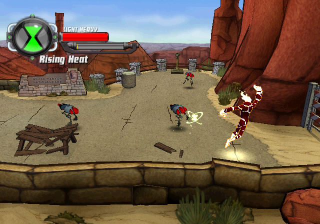

# 20: VU1 census, an offline VU1 replay, a faster VU interpreter, the GS on its own thread

Continues [19](19-windows-build-and-speed.md) s.8-10: in the first level the
VU1 interpreter was the largest cost, then the software GS renderer.

## 1. Which VU programs run in the first level

How: gdb breakpoints on `VU1Interpreter::execute` (VIF `MSCAL` and VU0
`VCALLMS` both end there) and `VU1Interpreter::resume` (VIF `MSCNT`),
printing the unit (`m_unit`), the start PC and the interpreter's cycle
counter, for about 20 seconds in the level. The cycles of a run are the
difference to the next start on the same unit.

- **VU0** (unit 0): about 17,000 calls, almost all at `0x38` and `0x140`,
  plus `0x0`: the skinning microprograms of [18](18-memory-card-and-menus.md)
  s.12, called by `VCALLMS`. The VU0 instance's cycle counter does not move
  between calls (it is reset at every call, s.12), so their cost is not in the table below; the
  stack samples put about 7 of 60 in them.
- **VU1** (unit 1): the work is in **resumed** programs (`MSCNT`). The
  `MSCAL` starts (`0x100`, `0x190`, `0x150`...) run 13 to 45 cycles each:
  set-up code that stops with the E bit; `MSCNT` then continues the
  rendering loops.

| VU1 resume PC | Runs | Share of VU1 cycles | Cycles per run |
|---|---|---|---|
| `0x2DF8` | 432 | 28.8% | 2,815 |
| `0x3BD0` | 261 | 16.3% | 2,639 |
| `0x0BF8` | 285 | 15.2% | 2,258 |
| `0x1038` | 215 | 10.9% | 2,141 |
| `0x3520` | 288 | 7.7% | 1,129 |
| `0x37B0` | 245 | 7.2% | 1,248 |
| 6 others | 305 | 13.9% | 1,264-2,857 |

- **Which code:** a dump of VU1 micro memory in the level matches the
  `.vutext` overlay entries **#13 to #20** ([11](11-vu-microprograms.md),
  group F), each 0x800 bytes at VMA 0x0, 0x800 ... 0x3800 (256 of 257 pairs
  match per entry; the extra pair is the VIF code around the upload). So
  the level's 3D drawing is group F, and the hot entry points above are
  inside it.
- **Uploads:** the decoded-instruction cache was rebuilt 217 times for VU1
  and 63 times for VU0 in 15 seconds (`rebuildDecodedCodeCache`): the game
  uploads microcode (VIF `MPG`) several times per frame.

## 2. An offline replay of VU1 work

To work on VU1 without the game, `tools/vu1_replay/capture_vu1.gdb` saves,
at a VU1 `MSCNT`, the code memory, the data memory and the interpreter's
`VU1State`; `ben10_vu1_replay` (built from `tools/vu1_replay/`) runs them
again through PS2Recomp's interpreter. With `--sum` it prints a checksum per
workload of every result (registers, flags, cycle count, VU data memory, GS
memory). Captures stay in `user/` (they are the game's code and data).

At every one of the 40 resumes captured, the interpreter's pipelines were
empty (`pipelinesPending() == 0`), so code, data and `VU1State` are the
whole starting state.

## 3. A faster VU interpreter (patch 0013)

`callgrind` on the replay (instruction counts do not depend on the
machine's load) showed the time in the bookkeeping more than in the
arithmetic: the pipeline commit pass on every cycle, the hazard check, the
copy of the decoded pair, `markPairWrites`, an out-of-line operand
normaliser. Patch 0013 changes those without changing what is computed:

| Step | Instructions for the 40 workloads |
|---|---|
| before the patch | 296.5 M |
| skip the commit pass until something is due; fast XGKICK drain (findings/19 s.9) | about the same (the scan came back as a recomputation) |
| earliest-ready found in the commit pass itself; decoded pair by reference | 256.7 M |
| hazard check and `markPairWrites` visit only the set VI bits | 234.0 M |
| commit pass visits only valid slots (one bit mask per pipeline array) | 221.1 M |
| `normalizeOperand` inline | 200.1 M |
| `run()` and the hazard check use bit scans for VI and lanes | 185.1 M |

About 36 M of the remaining instructions are the replay's own start-up and
decoding (the replay has no `PS2Memory`, so it does not use the decoded
cache); the VU work itself went from about 260 M to about 150 M. Every
step was checked: the 40 checksums are identical to those of the
interpreter before the patch.

The patch also decodes lazily after a code upload: the cache forgets its
pairs and decodes each one on first use, instead of decoding all 2,048 at
every upload (s.1: several uploads per frame). A pair's decoding reads
only its own 8 bytes, so this cannot change a result.

All 451 ps2xTest cases pass.

In the game (Linux, first level, the same route, about 85 s measured):

| Build | Game frames per second | VBlanks per second |
|---|---|---|
| before patch 0013 | 1.42 | 2.85 |
| patch 0013, first part (findings/19 s.9) | 2.03 | 4.05 |
| patch 0013, complete | 2.58 | 5.17 |

## 4. The GS rasteriser on its own thread

PS2Recomp's GS frontend draws through a replaceable backend
(`GS::setRasterBackend`). `src/gs/gs_async_backend.cpp` installs one that
wraps the CPU rasteriser (`GSCpuBackend`) and runs it on a thread of its
own: primitives, CLUT loads, image uploads and TEXFLUSH are queued (with
their data copied) and run in order by one worker; every call that reads
GS memory for the game (local-to-host transfers, `ReadVram`, snapshots) or
returns a result waits for the queue first. The GS memory after the same
commands is the same bytes. Details in the file's header.

Two problems found on the way, both fixed:

- **Unbounded queue.** The first version let the game run ahead without a
  limit; whenever drawing was the slower side the queue grew (the
  process's memory grew by about 100 MB every 5 seconds). Now the game may
  run at most 8,192 commands ahead (`kMaxPending`) and waits otherwise.
- **Lost key presses.** The window thread called `Sync(Presentation)` and
  `Present`, which first waited for the queue; sampled with gdb, it spent
  nearly all its time there, its loop got slower than a key press, and
  presses were missed (the menus did not react to a 1.2 s press, and
  barely to a 2.5 s one). Presentation does not need to wait: the CPU
  rasteriser copies the frame under its own lock, between two commands,
  as it did when the game thread drew. The picture shown can be a little
  behind the game; the game's own view of GS memory is not.

`BEN10_GS_SYNC=1` keeps the original synchronous backend, for comparisons.

Measurements: s.5.

## 5. Measurements

Linux, game code at `-O0` (runtime and IOP at `-O2`), under Xvfb; the same
route each time (start, New Game, Normal, first slot, the loading tip, the
first level); `BEN10_FPS_LOG` averages. Boot = the warning, intro and
title screens, 20 to 150 s after start; level = about 80 s after arriving.

| Build | Boot, game frames/s | Level, game frames/s | Level, VBlanks/s |
|---|---|---|---|
| before patch 0013 (findings/19 s.9) | 6-7 | 1.42 | 2.85 |
| patch 0013, GS synchronous (`BEN10_GS_SYNC=1`) | 6.81 | 2.76 | 5.53 |
| patch 0013, GS on its own thread | 8.60 | 4.13 | 8.27 |

In the level the game draws one frame every two VBlanks (it runs at 30
frames per second on the console), so 4.13 frames per second is about 14%
of full speed. The picture in the level is unchanged (screenshot compared
by eye with findings/18's).

The scripted route needed longer key holds (2.5 s instead of 1.2 s) while
the window thread still waited for the queue (s.4); with that fixed, the
route works with both backends.

## 6. Where the time goes with the GS thread

40 gdb samples of all threads in the first level (GS thread on):

| Thread | Busy samples | In |
|---|---|---|
| game thread | 36 of 40 | VU1 interpreter 28 (VIF1 kicks 18), VU0 skinning 7, IOP 6, the game's own code 16; waiting for room in the GS queue 4 |
| GS thread | 39 of 40 | `GSCpuBackend` (drawing) |

Both threads are nearly full; the GS thread slightly more. On this
machine (2 cores) there is no third core to give drawing; on a desktop
with more cores there is.

## 7. Row bands: drawing one picture on several threads

- Patch 0014 lets a `GSCpuBackend` draw only some rows of the picture
  (`SetRowBand`: rows y with `((y >> 4) % N) == k`). Several backends on
  the same GS memory that see the same commands in the same order write
  the same bytes as one (each pixel is drawn by exactly one band). A
  ps2xTest case draws blended, Z-tested triangles and a textured sprite
  with two bands, one after the other (the worst order), and gets the
  same frame and Z buffer as one backend.
- `src/gs/gs_async_backend.cpp` uses it with `BEN10_GS_THREADS=N`: the GS
  thread becomes a dispatcher that hands runs of draws, CLUT loads and
  TEXFLUSHes ("segments") to N bands (band 0 on the dispatcher itself)
  and waits for all of them before a transfer. A band must never read GS
  memory another band is still writing: the dispatcher tracks the 8 KB
  pages written in the current segment (frame and Z rows inside the
  scissor, over-estimated) and ends the segment before a draw whose
  texture pages, or a CLUT load whose CLUT page, are among them.
- The one difference left with N > 1: each band has its own copy of the
  GS texture page buffer, so stale texture data seen without a TEXFLUSH
  can differ. Games must TEXFLUSH after rendering to a texture.
- Default N = 1 (one GS thread, as in s.4): this machine has 2 cores, so
  the bands could not be measured for speed. Checked here: with N = 2 the
  game runs the same route into the first level, the picture looks the
  same, and the level runs at the same rate as with one band (about 4
  frames per second: no spare core).

## 8. The frame wait loop (src/overrides/draw_wait.cpp)

- In the samples of s.6 the game thread was often in the IOP interpreter
  called from `entry_0012e590`: the loop of `FUN_0012e580`, which spins
  until the VIF1 DMA end handler clears bit 0x10 of the flags at
  `0x00268548` or ten VBlanks pass (disassembly: `lw`/`andi`/`beqz`,
  `lw`/`slt`/`bnez`). Each turn counts 32 EE cycles at a checkpoint, and
  each checkpoint steps the IOP by 32 cycles. While the game waits, the
  PS2's clock, which brings the next interrupts, moves in 32-cycle steps,
  each paying the checkpoint's fixed cost.
- The override runs the same loop natively and counts 1024 cycles per
  turn: the loop only reads two words, so nothing on the EE side changes
  between turns; the interrupts that end it are taken at most 1024 cycles
  (3.5 microseconds of PS2 time) after they are due, instead of 32. EE
  timer interrupts inside a step are taken at its end.
  `BEN10_DRAW_WAIT_STEP=32` gives back the original step.
- Result (same route, GS thread on, one band): first level 4.13 -> 4.41
  game frames per second, boot screens 8.60 -> 9.03. Small here, because
  the GS thread is the limit on this 2-core machine (s.6); it matters more
  once drawing has more cores.
- Ben still walks in the level (W). Observed, not investigated: pressing
  Cross (X) in the level opened the pause menu ("Game Paused", with
  "Drop Player One"); also seen once before this change.

## 9. Face buttons opened the co-op pause menu (patch 0015)

- Symptom (s.8): in the first level every face button (Square, Triangle,
  Circle, Cross) opened "Game Paused" with "Drop Player One", and the next
  press closed it; the HUD (health bar, Omnitrix) sat at the top right.
- Cause: the runtime's pad code gave every opened port the same input
  (the keyboard and the first host gamepad) and reported every opened
  port STABLE. The game opens port 1 too, so it saw a second player whose
  buttons were pressed with player 1's: player 2 "joined" and the co-op
  menu came up. `PSPadBackend::readState` and the keyboard fallback in
  `readPadPortData` ignore the port.
- Fix (patch 0015): only port 0, slot 0 has a controller; for any other
  port/slot `scePadGetState` reports DISCONNECTED and `scePadRead` reads
  nothing. New ps2xTest case; 453/453 pass.
- Result: in the level, Square and Triangle now attack (the HUD names
  the combo, "Light", "Jab Roundhouse"), Cross jumps, and the HUD moved
  to the top left, the one-player layout (screenshot 09).
- A second player (a second host gamepad in port 1) is future work.

*Captured from this port (Linux). The picture shows the content of Ben 10:
Protector of Earth (High Voltage Software / D3 Publisher; Ben 10 is a
trademark of Cartoon Network); it is not the work of this project. See
[the screenshots README](../images/screenshots/README.md).*

## 10. Playing further in the first level

About ten minutes of play after patch 0015 (Linux, about 4 frames per
second, keyboard), no stop and no `missing-target` in the log:

- The Omnitrix works: Right Shift (R2) picks an alien on the dial, E (R1)
  transforms; Ben became Heatblast, drawn correctly (skinned model, fire
  effect).
- Walking on triggers the game's tutorial pop-ups ("Omnitrix
  Activation", "Combat"), closed with Cross.
- The first enemies appear with their introduction card ("Vilgax Drone",
  with toughness, strength, ranged, melee and speed bars); the fight
  works: Square/Triangle combos ("Rising Heat"), the combo counter, the
  drones attacking back. A "Loading" mark shows while the level streams
  more data.

*Captured from this port (Linux). The picture shows the content of Ben 10:
Protector of Earth (High Voltage Software / D3 Publisher; Ben 10 is a
trademark of Cartoon Network); it is not the work of this project. See
[the screenshots README](../images/screenshots/README.md).*

## 11. A palette cache for indexed textures (patch 0016)

- **Where the GS thread's time goes.** 60 gdb samples of the GS thread in
  the level: `SampleTexture` in 28 (the CLUT lookup 7, the swizzled
  address calculation 8, the texture page buffer's copy 3, `lroundf` of
  the bilinear blend 2), the rest of `DrawTriangle` in 37 (samples count
  once per frame they appear in).
- **The change (patch 0016).** Every T8/T4 texel, four per pixel with
  bilinear filtering, went through `LookupCLUT`: the CLUT index from CSA,
  CSM and the source format, the CLUT read, then the TEXA alpha rules.
  `SampleTexture` now keeps the final colour per source index in a
  256-entry table filled on first use. The table's key packs every input
  of `LookupCLUT` except the index and the CLUT itself (CPSM, CSM, CSA,
  4-bit or 8-bit source, TA0, AEM, TA1); every CLUT write sets the key to
  a value no draw state packs to. A hit returns exactly what `LookupCLUT`
  would. A new ps2xTest case reloads the CLUT and changes TEXA between
  draws (it fails if the CLUT load does not reset the key); 454/454 pass.
- **Tried and dropped:** replacing `std::lround` in the bilinear blend by
  an inline exact rounding made the same draw loop 20% slower than libm's
  `lroundf` here.
- **Measured.** A throw-away timing loop in ps2xTest (100 full-screen
  T8 triangles, CT16 CLUT, bilinear): 3.47 s before, 3.30 s after (-5%).
  In the game the frame rate of this cloud machine moved by up to 20%
  between two runs of the same binary (2.97 and 3.55 frames per second,
  first level, same route), so it cannot show a 5% change. CPU time per
  game frame of each thread (from `/proc`, 90 s in the level, with
  `tools/perf/cpu_per_frame.sh`):

  | Thread | Before | After (two runs) |
  |---|---|---|
  | GS thread | 306 ms | 274 ms, 285 ms |
  | game thread | 219 ms | 197 ms, 213 ms |
  | Mesa llvmpipe (presenting through Xvfb, 2 threads) | 64 ms | 54 ms, 54 ms |
  | main (window) thread | 24 ms | 21 ms, 22 ms |

  The four add up to about two cores' worth per frame: on this 2-core
  machine every thread's CPU time counts, including software OpenGL for
  the window, which a real GPU does instead.

## 12. Why the VU0 cycle counter does not move (s.1)

- Code: `PS2Runtime::executeVU0Microprogram` (`VCALLMS`/`VCALLMSR`) calls
  `m_vu0.reset()` before every call, which sets the interpreter's cycle
  counter to 0, then copies the EE's VU0 registers in, runs the program
  with a budget of 4,096 cycles and copies the registers back. So each
  call counts from 0: nothing is wrong with the counter, and nothing
  carries timing from one `VCALLMS` to the next.
- Is the 4,096-cycle budget ever reached? A gdb breakpoint after the run,
  30 s in the first level: 2,576 calls, all ended by the program (E bit)
  well inside the budget: 1,288 at `0x38` and 1,272 at `0x140`, 34 cycles
  each, and 16 at `0x0`, 7 cycles. No call is cut short.
- Left as it is: re-entering the VU0 program with no pipeline state is
  what the hardware does after a program has ended (KNOWN_ISSUES R22 is
  about VU0 running alongside the EE, not about this).

## 13. Playing further: scripted input is not enough

A 20-minute scripted session (Cross, W held 12 s, attacks, D, W again,
repeated) after reaching the first level moved Ben about one screen: at
3 frames per second a 12-second key hold is about one second of game time,
and the fixed pattern ended against the wall by the park sign. No stop,
no `missing-target`, no error in the log. Playing past the first fight
needs either more speed or input chosen by looking at each picture.

A second session, with each move chosen from a screenshot (about 15
minutes): the "Omnitrix Activation" and "Combat" tips, the drone
introduction, a first drone destroyed by Ben (combo of 6), then the next
clearing with three drones. R1 (E) transformed Ben into **Four Arms**,
drawn correctly, with its own combos ("Slapdown", "4 x Four", "All
Fours"); the drones hit back and the health bar went down to almost
empty when the session was stopped. No stop and no `missing-target` in
the log.

## 14. Where the VU interpreter's time goes, and what group F reads (input for D14)

**Profile.** `callgrind` of `ben10_vu1_replay --reps 10` (40 workloads,
1.11 million VU cycles), instructions in the VU code only:

| Part | Functions | Instructions |
|---|---|---|
| Pipeline bookkeeping | `commitReadyPipelines` 181M, `calculatePairReadyCycle` 128M, `markPairWrites` 104M, `queueVfWrite` 51M | 464M |
| FMAC result and flag model | `calculateFmacExactResult` 108M, `updateFmacFlags` 62M, `normalizeFmacResult` 50M, `normalizeFmacExactResult` 37M, `calculateFmacProductSticky` 34M | 291M |
| The operations | `execUpper` 144M, `execLower` 61M | 205M |
| The pair loop | `run` 167M, `getDecodedInstructionPairForPc` 48M | 215M |
| Decoding | `decodeInstructionPair`, `decodeLowerUsage`, `decodeUpperUsage` | 141M |

About 1,200 host instructions per VU cycle. The decoding line is mostly an
artefact of the replay: it passes no `PS2Memory`, so the interpreter
decodes every pair at every step; in the game the decoded pairs are kept
until the next code upload. Without it, the VU code takes 1,175M
instructions; the shares below are of that.

**What group F reads.** The VU1 code memory captured in the level (group
F, 2,048 instruction pairs) counted with `tools/analyzer/vu_disasm.py`:

- 769 of the 2,048 upper instructions and 509 lower ones are NOPs;
  the lower side is mostly loads and stores (384 `LQ`, 139 `SQ`, 28 `LQI`,
  27 `SQI`, 61 `ILW`, 58 `ISW`) and integer work for addresses and loops.
- Flag reads: 21 `FMAND` and 3 `FMEQ` (MAC flags), 20 `FCGET` and 12
  `FCAND` (clipping flags, written by 20 `CLIPw`). No status-flag read
  (`FSAND`, `FSEQ`, `FSOR`) and no `FSSET`.
- FDIV: 43 `DIV`, 4 `RSQRT`, 14 `WAITQ`. No EFU instruction (no `E...`,
  `MFP` or `WAITP`). 12 `XGKICK`.

**What this means for the native VU1 (D14).**

- A translation that keeps the interpreter's model (phase 1) saves the
  pair loop (18%) and the dispatch inside `execUpper`/`execLower` (part
  of their 17%): at most about a third.
- The bookkeeping (about 40%) goes away only where the translator works
  out the timing at translation time (phase 2): the pipelines are empty at
  every resume (s.2), so each block's timing can be computed from its
  entry.
- The flag model (about 25%) is needed only for results whose MAC flags
  can reach one of the 24 MAC-flag reads before the next FMAC instruction
  replaces them; the status flags are never read inside group F. Whether
  the EE reads VU1's status register was not checked; the replay's checksum
  includes it, so a translation that stops computing it needs that
  checksum changed on purpose, with the reason written down. The
  exact-result part also decides overflow and underflow values, so only
  the flag half can go.

## 15. Longer IOP steps: tried, not kept

- **Idea.** The scheduler gives the IOP the EE's elapsed time at every
  checkpoint: 32 EE cycles, 4 IOP cycles. Each IOP step services DMA
  interrupts, callbacks and timers and switches into a thread and out
  again, for 4 cycles of work. A runtime change (`EeScheduler::setIopStepCycles`,
  default unchanged) collected the cycles and handed them over in steps
  of at least 256 EE cycles; a ps2xTest case checked that the IOP still
  got every cycle.
- **Measured** (first level, same route): game thread 221 ms of CPU per
  game frame with the old step, 211 ms with 256: inside the spread of
  repeated runs of one binary (197-221 ms, s.11).
- **Why so little.** 50 gdb samples of the game thread in the level with
  the old step: VU1 interpreter 28, waiting for room in the GS queue 16,
  other 6, the IOP 0. Since the frame wait loop runs natively (s.8), the
  IOP no longer shows in the level; and on this 2-core machine the game
  thread spends a third of its time waiting for the GS thread.
- Not kept: a timing change with no measured gain. The patch and the
  override were removed before committing; this section is the record.

## 16. Windows: the keyboard did nothing (patch 0017)

- Symptom: the Windows build (MSVC Release, commit `a09e8fa`) booted,
  found the save and showed the title screen at about 7.6 game frames per
  second, but no key did anything, for the maintainer at the keyboard
  either.
- Cause: PS2Recomp's pad backend read either the first host gamepad or
  the keyboard. When raylib reports gamepad 0 as available (a connected
  controller, or any device Windows presents as one), the keyboard was
  never read. The Linux test machine has no gamepad, so it never showed
  there.
- Fix (patch 0017): both are read; a key and a gamepad button for the
  same PS2 button both press it, and W/A/S/D override the gamepad's left
  stick on their axis. The first read logs `[pad] gamepad 0: <name>` or
  `[pad] no gamepad: keyboard only`. Linux, no gamepad: Start still opens
  the main menu; ps2xTest 454/454.
- On Windows with patch 0017 the keyboard works (the maintainer played
  from the title screen into the menus and on). The first read logged
  `[pad] no gamepad: keyboard only`, so the cause is not confirmed: raylib
  may report a gamepad only later in the run, which the old code would
  have answered by ignoring the keyboard, but no log shows it.
  `BEN10_KEY_LOG=1` (src/diagnostics/key_log.cpp) logs the keys raylib
  sees and the window focus, for the next time keys go missing. Keys sent
  by the remote-control tool still did not reach the game window.
- Windows speed in that session (MSVC Release): about 7.6 game frames per
  second on the title screen, 5.6-8 per second in one-minute averages
  over the 14-minute session.

## 17. The game stopped in a fight: virtual methods missing from the function list

- Symptom (Windows, first level, a fight as Four Arms): the game stopped.
  The log: `[guest-branch:missing-target] kind=IndirectCall op=JALR
  source=0x1ee234 target=0x20f648`: a virtual call (the method pointer
  read from a virtual table at `0x00238ADC`) into code that had no
  generated function.
- `0x0020F648` is a 12-instruction leaf method (stores `$a1` at +0x5C and
  sets or clears bit 0x80 of the word at +0x18). Ghidra had not made it a
  function and `CreatePointerTargetFunctions.java` rejected it: it starts
  with a branch, and between the previous function's `jr $ra` and it sit
  stray words the toolchain leaves between functions (`nop`,
  `addiu $sp, $sp, 32`, `nop`), so rules b and c did not apply.
- A scan of the ELF for data words that point into code no function
  covers found 21 such targets. Besides `0x0020F648`: 10 more virtual
  methods in the same range (`0x002061D0`-`0x0020E570`; several are
  destructors that load their table address before the prologue,
  `lui $v0` then `addiu $sp, $sp, -16`), a function at `0x001A5F50`, two
  words at the start of `.text` that are not code, a tail-call thunk at
  `0x00205578`, and switch cases after `jr $a0` at `0x001C0F7C`-`0x001C105C`
  (a table in `.data`).
- Two new rules in `CreatePointerTargetFunctions.java`:
  - d: the second word is a stack-frame prologue and the first is not a
    jump or branch;
  - e: a leaf virtual method. The target is 8-byte aligned; a pointer next
    to it in data (one or two words away) points at the start of an
    existing function, which holds for virtual tables and not for switch
    jump tables (their entries point inside a function); and it follows a
    `jr $ra` or `j` and its delay slot with at most 7 words in between,
    each word just before an 8-byte boundary being padding. Rule e runs in
    a second pass, after the other entries of the table exist. Targets
    with a prologue are now handled first, so a function created by rule
    d cannot swallow the next one (`0x001A5F50` runs into `0x001A6068`).
- Result: 13 new functions (`0x001A5F50`, `0x001CA840`, which was already a
  synthetic entry, and the 11 methods): the script creates 394 functions
  instead of 381, and the exported list (21,057 entries) is otherwise
  unchanged. The thunk at `0x00205578`
  and the `0x001C0F7C` switch cases are still rejected (recorded in Open).

- Tested on Windows with the new list: the maintainer played past that
  fight to the first Sumo Slammer card; no `missing-target` in the log.

## 18. GS row bands on Windows: 6 by default

Measured on the maintainer's Windows desktop (MSVC Release, game frames
per second from `BEN10_FPS_LOG`, one-second samples):

| `BEN10_GS_THREADS` | Menus | First level |
|---|---|---|
| 1 | about 11 | about 7.5 (short sample) |
| 4 | about 24 | 4-8 |
| 6 | about 48 | 5.5-8 |

The menus are limited by drawing and scale with the bands; the first
level is not: there the game thread (the VU1 interpreter, s.6, s.14) is
the limit. The picture looked right with 4 and 6 bands. The default is
now 6 bands when the machine has at least 8 hardware threads (hardware
threads - 2 below that, 1 below 4); `BEN10_GS_THREADS` still overrides it.
In the session of s.17, with the default of 6 bands: 5.4-7.2 game frames
per second in one-minute averages in the first level.

## 19. Open

- `CreatePointerTargetFunctions.java` still rejects the thunk at
  `0x00205578` (`lui`, `j`, `addiu`) and the switch cases at
  `0x001C0F7C`-`0x001C105C` (jump table in `.data`): either can stop the
  game the same way if it is ever reached (s.17).
- Native VU1 (decision D14): translate group F and the VU0 skinning
  programs; `ben10_vu1_replay` is the reference.

## 20. The busiest GS band: page sets, and lround in the bilinear filter (patch 0036)

- Seen on Windows with the async VIF1 option (findings/21 s.22): one of
  the six band threads always used 20-30% more CPU per game frame than the
  others, and with the VU1 worker it is the next limit.
- That thread is band 0, which runs on the dispatcher thread. Linux,
  `perf record -t` on both GS threads with `BEN10_GS_THREADS=2` (with one
  band the page sets are not used), first level, 30 s each: 17% of the
  dispatcher thread went to building page sets (`writtenPages`,
  `texturePages`: `std::bitset<512>` filled page by page, about 280 bits
  per primitive for the frame and Z rows of a full-screen scissor), for
  every primitive. Both threads also spent about 7% in `lroundf` (through
  the PLT), called per channel of every bilinear texture sample by
  GSCpuBackend's `lerpChannel`.
- `src/gs/gs_async_backend.cpp`: the dispatcher keeps the last page set
  of each kind with its inputs (frame FBP/FBW, Z ZBP/ZMSK, scissor rows;
  texture TBP0/TBW/height/vertical wrap) and reuses it while they are the
  same: the same sets, built only when the inputs change. Page-set work
  on the dispatcher thread: 17% -> 0.5%.
- Patch 0036 (runtime): `lerpChannel` rounds with an inline
  `roundHalfAwayFromZero` (truncating conversion, then the exact
  remainder compared with 0.5). Checked equal to `std::lround` for every
  float in [-300, 300] in all four rounding modes (9.07 billion values,
  throwaway test); ps2xTest 454/454.

## 21. GS bands: counters, a recorded command stream, transfers without a barrier, and a race between bands

- Seen: on Windows with the async VIF1/VU1 option the VIF1 worker uses
  only 40-70% of a core and the game thread waits for it at every other
  VBlank (findings/21 s.26), while each of the six GS bands is busy about
  80% of the time. Nothing said what the worker or the bands were
  waiting for.
- Counters (`src/gs/gs_async_backend.cpp`, a `[gs-async]` line every 10 s
  of drawing): draws and parallel segments, why each segment ended
  (texture, CLUT, transfer, length, idle, layout), how long band 0 drew
  and then waited for the other bands, how often producers were held by
  the queue limit and how long readers waited in `drain()`. First level on
  the 2-core Linux test machine (1 band by default there; with
  `BEN10_ASYNC_VU1=1`, about 5 game frames per second): about 40,000
  draws per second, ending about 200 segments per second at transfers;
  the dispatcher drew 98% of the time and producers were held 85% of the
  time (there the GS is the limit by far). With 6 bands forced on the same
  machine: about 250 texture and 210 transfer barriers per second.
- A recording of the backend's input, to compare backends exactly and
  time them on the same work (the game's frames are not reproducible run
  to run): `BEN10_GS_RECORD=<file>` (`BEN10_GS_RECORD_AFTER=S`,
  `BEN10_GS_RECORD_SECONDS=S`; `src/gs/gs_record.h`) writes GS memory and
  then every backend call; `ben10_gs_replay FILE --sync | --bands N`
  (`tools/gs_replay`) replays it and prints a hash of GS memory every N
  records (`--dump N F` and `--list A B` to look closer). The recording
  is game data and stays in `user/`. First level, 15 s, 6 bands: 695,840
  records (658,549 draws), 257 MB.
- What the replay showed first: with more than one band the result was
  **not** the one PS2Recomp's GSCpuBackend draws (`--sync`), and not the
  same from one run to the next (6 bands: a different hash after 1,250
  records on each run, the pre-existing code too). `--dump` at that point
  and a page-by-page diff: 8-9 pages differed, inside the area at page
  220, and `--list` showed the cause: triangles drawn to the frame at
  page 80 with their 24-bit Z buffer (PSMZ24) at page 220, then sprites
  drawn with FRAME at page 220 (PSMCT32), in the same segment. The band
  rule (band k draws the pixel rows with `(y >> 4) % N == k`) assumes
  that a byte of GS memory always belongs to the same pixel row, but the
  PSMZ formats order the blocks of a page differently from the PSMCT
  ones (rows 0-15 of one hold the bytes of rows 16-31 of the other), so
  two bands wrote the same bytes, in whatever order the threads ran.
- Fix: the dispatcher records, for the current segment, the pages each
  buffer layout (base page, FBW, pixel format) has used for frames and
  Z buffers; a draw whose frame or Z pages were already used through
  another layout first lets every band finish (`layoutConflict`; Z
  counts when it is written or tested). About 20 such barriers per second
  in the first level.
- Also in this step:
  - Transfers: an image transfer used to end the segment, always (it
    runs on the main backend). Now a host-to-local transfer whose pages
    (`transferWritePages`: by pixel format, the page rows of the
    rectangle, one more page when DBP is not page-aligned; any other
    format or a rectangle past row 2047 gives every page) are not read or
    written by any draw or CLUT load of the unfinished segment runs at
    once, ahead of those draws, while no band is drawing. On the
    recording about 78% of transfer commands run this way; the others
    still wait.
  - The written-page sets started at row `y0 / 32` of the scissor; for a
    16-bit frame or Z buffer (64x64-pixel pages) a scissor starting at
    row 32 missed the page that holds rows 32-63. The first row is now
    rounded down to 64. CLUT loads read one more page when the CLUT can
    run past the end of the page of CBP.
- Checked: the recording replayed with 2, 3, 4, 6 and 16 bands gives the
  same GS memory as `--sync` at the end, and with 6 bands at all 35
  intermediate points too, on two runs; with 1 band, the same at every
  point. The game, with all of this and 6 bands, goes from New Game to
  the first level on Linux and draws it (with `BEN10_ASYNC_VU1=1`: about
  15 layout, 200 transfer and 240 texture barriers per second, and about
  700 transfer commands per second ran ahead of the segment). Not measured yet: the frame rate on a machine with the cores
  for 6 bands (the Linux test machine has 2).
- Seen and not done yet: about half of the remaining barriers are
  texture barriers from full-screen effects that sample the frame just
  drawn at page 80 in strips. The texture page set covers the whole
  texture height given by TEX0 (1024 rows here), so each strip written at
  page 371 also looks like a texture read of the next strip; the rows the
  primitive's texture coordinates can reach would be much fewer.

## 22. Windows with the GS counters: the GS holds the producers half the time; the filter four channels at once (patch 0039)

- Measured by the maintainer on Windows (MSVC Release build of commit
  bc84156, `BEN10_ASYNC_VU1=1`, 6 bands; menus, then the first level
  with enemies; `[gs-async]` lines and `cpu_per_frame_windows.ps1`).
- Before the level (the title and menus): 30 game frames per second,
  about 10,800 draws per second, 1,490 segments per second, nearly all
  ended by texture barriers (1,170 per second); nobody held by the queue.
- In the first level, per 10-second line: 1.2-2.2 million draws (about
  8,000 per game frame), 20,000-30,000 segments, ended by texture
  9,300-11,600, transfer 6,000-9,200, length 1,100-2,700, layout 520-700,
  idle 220-9,100; 20,000-34,000 transfer commands ran ahead of their
  segment. Band 0 (the dispatcher's thread) drew 7.3-7.6 s and waited
  1.8-2.1 s for the other bands; **the producers (the VIF1 worker and the
  game thread) were held by the queue limit 5,300-11,700 times, 3.3-5.3
  s of every 10**; no drains.
- CPU time in the level: the dispatcher thread 780-830 ms per
  second (it draws band 0 and dispatches), the other five bands 580-770;
  the VIF1 worker 370-630, game thread 360-430. Game frames per second:
  18-20 with enemies (as in findings/21 s.26), 25-30 in quieter parts.
- So the GS is the limit: the dispatcher thread is busy about 95% of the
  time (drawing, then waiting for the slowest band at each barrier), the
  queue fills, and the VIF1 worker and with it the game thread wait.
- How the drawing cost splits (`ben10_gs_replay --row-band K N`, new: one
  band's share drawn alone on GSCpuBackend; the 15 s recording of s.21):
  the whole picture 16.4 s, band 0 of 6 3.19 s, band 3 of 6 2.86 s, band
  0 of 2 7.99 s. One sixth would be 2.74 s: the per-primitive work every
  band repeats is small, nearly all of it is per pixel. perf on the
  replay: bilinear filtering per channel (`lerpChannel`) 24%, the texel
  fetch (`SampleTexture` lambda, `ReadTexture`, wrap) 24%, the rest of
  `SampleTexture` 10.5%, `DrawTriangle` 14%, `WritePixel` 12%.
- Patch 0039: `bilinearFilter` filters the four channels in one SSE2
  vector with the same single-precision operations in the same order,
  then rounds and clamps per lane: the same bits. Checked on 345 million
  inputs against the per-channel code (throwaway test, x86-64 and
  x86-64-v2 builds), the replay's hashes at all 35 points and at the end
  are the same, ps2xTest 454/454. Replay time on GSCpuBackend: 16.4 s ->
  13.2-14.0 s (about -16%); each band draws its share with the same code.
- Next places in the replay profile (after 0039): `SampleTexture` 21%
  (now with the filter inlined), the texel fetch lambda 16%,
  `DrawTriangle` 15%, `WritePixel` 15%, `ReadTexture` 11%. And on the
  dispatcher's side: band 0 should not wait about 20% of the time for the
  other bands (fewer barriers: texture rows from the texture coordinates
  instead of the whole TEX0 height, s.21 last point), or the dispatcher
  could stop drawing a band of its own.
- Windows after patch 0039 (maintainer, commit a0ff5da, same settings;
  2 min 40 s of the first level with nearly continuous fighting, and a
  screen recording of it): 15.7-22.8 game frames per second, mostly
  17-20 (the recording shows 16-20 distinct pictures per second); 1.4-2.4
  million draws per 10 s; producers held by the GS queue 3.2-5.7 s of
  every 10; band 0 drew 7.2-7.9 s and waited 1.6-2.1 s. About the same
  as before 0039 in a scene with more fighting, so the gain is not
  separable from the scene in this run; the GS is still the limit. The
  recording shows the level drawn correctly (HUD, effects, tutorials, no
  missing or flickering surfaces seen).

## 23. GS per-pixel work and texture rows (patch 0040)

- What the bands draw (throwaway counters on the 15 s replay of s.21,
  GSCpuBackend): 75 million pixels of textured triangles (24-bit Z test
  GEQUAL, alpha blending, mostly 8-bit and 4-bit indexed textures with
  bilinear filtering and S/T/Q coordinates), 84 million of untextured
  sprites with Z test ALWAYS (half without blending or masks: the game's
  buffer clears), 42 million of textured full-screen sprites (the
  effects; one of them into a PSMCT16S frame). Texture samples: 59 million
  PSMT8 and 23 million PSMT4 bilinear, 21 million PSMCT32 point and 26
  million PSMCT32 bilinear.
- Patch 0040 (runtime, same results bit for bit):
  - bilinear sampling wraps u0, u1, v0, v1 once each (8 calls before),
    reads the four texels with `GSMem::ReadTexture4` (one format
    dispatch, the same reads in the same order through the texture page
    cache) and checks the palette key once per sample;
  - untextured sprites whose writes cannot depend on memory (no frame
    read, Z test NEVER or ALWAYS: `constantPixelWrites` follows
    WritePixel for that case) work out the frame and Z values once and
    write them pixel by pixel, frame then Z.
  Replay on GSCpuBackend, best of 3, two rounds: 13.5-14.4 s -> 12.1-12.4
  s (the test machine's times vary by about 10%); same hashes at all 35
  points; ps2xTest 454/454.
- Texture page sets (`src/gs/gs_async_backend.cpp`): the remaining
  texture barriers were nearly all the full-screen effects. They draw
  32-pixel-wide sprite strips into the frame at page 371 that read the
  frame at page 80 (640x448) as a 1024x1024 texture, and a set covering
  all 1024 texture rows contains page 371, so every strip ended the
  segment of the strip before it. The dispatcher now works out the rows a
  primitive can read (`textureRows`):
  - sprites: DrawSprite's float arithmetic for the first and last drawn
    rows, then SampleTexture's conversion to texel rows (FST: 1/16
    steps; bilinear: floor(v - 0.5) and the next row; point: trunc),
    with V nudged by 1/1000 texel each way so that a rounding difference
    cannot move a bound;
  - triangles: the range of T/Q x height (or V/16) over the vertices,
    widened by 2 texels plus 1e-3 x (largest Q / smallest Q) x the range,
    for DrawTriangle's edge weights down to -1e-4;
  - then the vertical wrap mode (CLAMP and REGION_CLAMP clamp the range;
    REPEAT keeps it only when it does not fold); anything else (points,
    lines, Q of mixed sign or near 0, FST reaching below 0, REGION_REPEAT)
    gives the whole height as before.
  The page sets now also use each format's own page size (64x32, 64x64,
  128x64, 128x128) and the columns the scissor or texture width reaches:
  the earlier rounding of the first row to 64 (s.21) did not fix 16-bit
  buffers whose scissor starts at row 64 or below, and wide textures on a
  narrow TBW were not fully covered.
- Result on the recording, per 658,549 draws, 6 bands: texture barriers
  3,535 -> 730, segments 7,387 -> 3,935, transfer barriers 2,916 ->
  2,119 (smaller read sets let more transfers run ahead). The rest of the
  transfer barriers are real: texture uploads into pages that queued
  draws of the segment still read. The replay gives the same GS memory as
  `--sync` with 2, 3, 4, 6 and 16 bands, and with 6 bands at all 35
  points. 6-band replay on the 2-core test machine, best of 3: 10.4-10.7
  s -> 8.9-9.8 s (it cannot run 6 bands at once; the Windows run will
  tell). The game reaches and draws the first level on Linux with 6
  bands.
- The `[gs-async]` line is now also printed when the backend is
  destroyed (the last stretch of a run, and short replays).
- Windows after this step (maintainer, commit b753a19, same settings;
  first level with enemies): **22.9-25.7 game frames per second** (per
  second mostly 23-28; 16.3-22.8 in the run before, in a heavier fight),
  texture barriers 2,300-2,700 per 10 s (9,300-14,000 before), 2.0-2.5
  million draws per 10 s, producers held by the GS queue 2.5-4.1 s of
  every 10 (3.2-5.7 before). The GS is still the limit, by less.

## 24. Random GS recordings; four holes in the band rule closed; triangle edges four pixels at a time (patch 0041)

- A recording from the game only covers the states the game used in
  those seconds. `tools/gs_replay/gs_synth.cpp` (`ben10_gs_synth OUT
  --seed N --records N`) writes a recording in the same format with
  random GS memory and random records: triangles, strips, fans, sprites,
  points and lines over every colour, Z and texture format, wrap mode,
  filter, coordinate mode, alpha and destination alpha test, Z test,
  blending, fog, FBMSK and FBA, plus CLUT loads (both CSM modes), image
  uploads and TEXFLUSH. By default it puts a TEXFLUSH before every
  textured draw and never lets a draw sample its own frame or Z pages
  (undefined on the GS); `--any-texture 1` drops both, for comparing two
  versions of GSCpuBackend alone.
- GSCpuBackend: three recordings of 40,000 random records with
  `--any-texture 1` give the same hashes (20 points each) before patch
  0039, after 0039, after 0040 and with 0041 below.
- The row bands did **not**: with 2 or 6 bands the random recordings
  ended differently from GSCpuBackend, and differently from run to run.
  Turning features off one at a time in the generator found:
  1. A draw whose scissor reaches past its buffer's width: pixels past
     the edge land in the pages of lower rows, so two rows of one draw,
     in two bands, share bytes.
  2. A draw whose frame and the Z buffer it touches share pages: a frame
     row of one band and a Z row of another write (or read) the same
     bytes.
  3. Z read with TEST.ZTE clear: GSCpuBackend applies ZTST whatever ZTE
     says, but `touchesZ` looked at ZTE, so such a Z read was not in the
     layout rule of s.21.
  4. CLUT loads in CSM2 read row COV from column COU x 16 of a buffer
     CBW x 64 wide, not the 16x16 block at CBP that `clutPages` counted.
  And one mistake of s.23: the memo of the written-page sets did not
  have the formats and the scissor's right edge in its key, which the
  page sets had come to depend on.
- Fixes (`src/gs/gs_async_backend.cpp`): `touchesZ` ignores ZTE;
  `clutPages` covers the CSM2 row; the memo key has every input; and a
  draw that overlaps itself (1, 2, a buffer covering all of GS memory, or
  a texture on pages the draw writes) is made whole, in order, by the
  main backend once the bands have finished (`drawsOverItself`). The main
  backend now also gets every CLUT load and TEXFLUSH, at dispatch time,
  so its CLUT is the bands'. The check uses the scissor's page sets
  first and, only when they overlap, redoes it with the pixels the
  primitive can reach (DrawSprite's rectangle, DrawTriangle's box): the
  first level's full-screen strips have a scissor 64 rows taller than
  the frame, reaching the Z buffer's pages, but stay above those rows.
  In the level recording: 0 such draws.
- Checked: 2, 3, 4, 6 and 16 bands give the same GS memory as
  GSCpuBackend on eight random recordings (30,000 records each, seeds 1,
  2, 3, 11, 12, 13, 21, 22; 2, 6 and 16 bands on all, 3 and 4 on six)
  and on the level recording.
- Patch 0041 (runtime, same results bit for bit): DrawTriangle computes
  the three edge weights and the edge test for four pixels of a row at
  once with SSE2 (the scalar expressions' operations in the same order),
  and interpolates the four colour channels and S, T, Q as vectors.
  Level replay on GSCpuBackend, best of 3, two rounds: 11.0-11.6 s ->
  9.95-10.4 s; same hashes on the level and random recordings;
  ps2xTest 454/454.

## 25. Per-primitive setup and inlined pixel steps (patch 0042)

- Measuring: wall times on the 2-core test machine vary by about 10%
  between runs, too much for changes of a few percent. `ben10_gs_replay
  --limit N` (new) stops after N records, so `valgrind --tool=callgrind`
  can count instructions on a part of a recording: the first 60,000
  commands of the level recording take 15.84 G instructions before this
  step, 0.40 G of them the replay's own loading (`--limit 0`).
- Where they went (callgrind, GSCpuBackend): WritePixel 20%, then
  SampleTexture's two parts 23%, DrawTriangle 8%, combineTexture 5%,
  ReadTexture4 7%, wrapTextureCoordinate 2.3%. WritePixel was spread
  thin: its entry (11% of its own time in perf), the buffer bases and
  formats worked out again for every pixel, VRAM accessors through the
  per-format table, then the tests.
- Patch 0042 (runtime, same results bit for bit), with the instruction
  count after each part:
  - PixelSetup, made once per primitive by DrawTriangle and DrawSprite:
    buffer bases, FBW, formats and the frame and Z accessors (15.69 G);
  - SamplerSetup the same way for SampleTexture (texture size, wrap modes
    and region, indexed or not, palette key), the palette key checked
    once per primitive (BeginSampling; the palette cache only memoises
    LookupCLUT, so when it is emptied does not change a texel), and the
    four bilinear texels converted with one format switch (14.51 G);
  - WritePixelWith, SampleTextureWith and combineTexture forced inline
    into the primitive loops (12.74 G);
  - the Z test before the frame read (both are reads only; a failed Z or
    destination alpha test ends the pixel either way) (12.59 G);
  - wrapTextureCoordinate and classifyAlphaTest forced inline (12.36 G).
  Drawing alone (less the 0.40 G of loading): 15.44 G -> 11.96 G, -22.5%.
  Wall time on the level recording, best of 3, two rounds: 10.3-11.1 s
  -> 9.2-9.3 s.
- Checked: same hashes on the level recording (35 points and the end);
  eight random recordings with draws sampling their own buffers
  (`--any-texture 1`, seeds 1-8) give the same hashes as before the patch
  (seeds 1-4 checked at the second part, 5-8 with all of it); 2 and 6
  bands give the same GS memory as GSCpuBackend on eight more random
  recordings; ps2xTest 454/454.
  The game reaches and draws the first level on Linux with 6 bands.

## 26. Dips with enemies: the VIF1 worker is the limit again; frame pacing in the log; the GS queue without allocations

- Measured by the maintainer on Windows (commit 99c53f0, patches up to
  0042; `BEN10_ASYNC_VU1=1`, 6 bands; first level, about 2 minutes): the
  game runs at 28-32 frames per second (per-second log) in quiet parts,
  the cap of a game that shows a new picture every second VBlank, and
  drops to 19-26 when enemies are on screen, which the maintainer sees
  as stutter. 10-second averages 21.3-30.0.
- In the dips the busiest thread is the VIF1/VU1 worker: 827-888 ms of
  CPU per second (34-42 ms per game frame, against 33 ms for 30 per
  second), ahead of the busiest GS band (760-800). The game thread waits
  for it at VBlank (36.6% of the game thread's samples in
  `PS2Memory::syncVif1`), and the GS queue holds the worker 0.6-4.1 s of
  every 10. So with enemies (more models to transform and draw) the VU1
  work per frame passes the 33 ms budget.
- Where the worker's time goes (Linux, `perf record -t` on the worker,
  40 s in the first level, `BEN10_GS_THREADS=2`; the port's own code is
  built without optimisation in that build, which inflates its share):
  VU code (translated blocks, pair and word functions, interpreter
  helpers) 61%; pushing draws into the GS queue 12.6% (`Submit`, `push`,
  the variant copies) plus 9% in malloc, mutex and memmove; kernel 5%;
  VIF/DMA 4.9%; the GS frontend (GIF registers, vertex kicks, batches)
  3.7%.
- The queue: `std::deque<Command>` keeps one command per block at this
  size (a primitive batch is 312 bytes), so every draw cost an allocation
  on the producer and a free on the dispatcher, with libstdc++ and MSVC
  alike. Now two `std::vector<Command>`, each reserved for the whole queue
  limit, are swapped between the producers and the dispatcher: no
  allocation per draw after start-up. Same commands in the same order
  (the level recording gives the same GS memory with 1 and 6 bands).
- Frame pacing: `[fps]` lines now also count the finished frames by host
  time since the previous one (up to 34 ms, to 50, to 100, longer) and
  give the slowest, so a lower average and a single stall can be told
  apart. Not VBlanks: the port's VBlanks follow the EE's clock, which
  slows down with the port (the Windows log shows 38 to 66 VBlanks in a
  seconds), so a slow port makes the game run slower rather than skip
  VBlanks; a first version counted VBlanks per frame and always saw 2.
- Patch 0043: the worker names itself `VIF1Worker` (before, on Linux it
  inherited "GameThread"), so `BEN10_PROFILE_THREAD=VIF1Worker` samples it
  on Windows.
- Next: a Windows profile of the worker in the dips (`run-worker.bat`),
  then the VU work it shows (s.25 of findings/21 lists upper words,
  block bodies and the run loop as the largest parts per VU cycle).

## 27. The worker in a fight, profiled on Windows; VIF1 UNPACK fast paths (patch 0044)

- Measured by the maintainer on Windows (commit 42eab78, `run-worker.bat`:
  `BEN10_PROFILE_THREAD=VIF1Worker`; first level, fights). Per second:
  29-33 game frames when quiet, 21-25 in the heaviest fight, where every
  frame took 40-50 ms of host time (the new pacing counts: no frame on
  time in those seconds, almost none over 50 ms) and only 42-50 VBlanks
  passed. Stalls over 100 ms: two, at the level's start (203 and 169 ms).
  So the "stutter" is a steady slowdown of the whole game in fights, not
  single stalls.
- The worker in the two busiest 10-second windows (about 10,300 samples):
  VU1 translated code 35% of its samples, the VU interpreter's helpers
  15% (`materializeFlags` alone 6.4%: applying the FMAC flag entries, one
  per FMAC, when a flag instruction reads them), `processVIF1Data` 6.5%
  (UNPACK), waiting in `ntdll` 17%; inclusive: XGKICK and the GIF path
  into the GS frontend 14%, of which the push into the GS queue 11%
  (mostly the queue limit: producers held 0.5-4.8 s of every 10).
- Patch 0044: UNPACK without a write mask and without row addition
  (MODE 0 or 3) stores each decompressed vector whole instead of going
  through the per-field mask loop, and V4-32 with CL == WL is copied in
  bulk. Same VU1 memory as before for 200,000 random VIF1 packets
  (throwaway program, both builds); ps2xTest 454/454.
- What is left in a fight is mostly the VU1 work itself. The next large
  step there is the cost of the FMAC flags (each FMAC computes its MAC
  and status bits, queues an entry, and the entry is applied later),
  which only matters where a flag instruction or a later program reads
  them.

## 28. The FMAC flag cost; a compact flag ring (patch 0045) and flag results left out in translated blocks (patch 0046)

- Measured on the 40 captured VU1 workloads (`ben10_vu1_replay
  user/vu1_captures --native --reps 20` under callgrind with
  `--toggle-collect='VU1Interpreter::run(*'`): 451.8 M instructions for
  2.2 M VU cycles. A note for later measurements: 112.5 M of them are
  `resolveNativeCode`, because the replay gives the interpreter no
  PS2Memory, so the translated functions are looked up again for every
  workload. In the game the lookup is redone only after a code upload
  (generation counter), so that part is left out of the numbers below
  (339.3 M without it).
- The flags, per source line: about 0.86 M FMAC flag entries, each
  costing about 15 instructions to decide its flags (fmacFlagsFast), 21
  to queue and 41 to apply in materializeFlags. That is about 22% of the
  VU work. In the disassembly of a translated MADD (`MADDw.xyzw`), about
  95 of its 130 instructions are flag work. materializeFlags is called
  mostly by FCAND/FMAND-type reads in the transform loops, about 4 due
  entries per call.
- Patch 0045, a compact ring: an entry is its due cycle (the issue cycle
  is always 4 less), MAC, the status word ready to OR in, the clip word
  and one byte saying what it writes; no valid flag (an entry in the ring
  is live). materializeFlags exits at once when nothing is due, then loads
  and stores the registers once per call instead of once per entry. Same
  values in the same order: 339.3 M -> 328.3 M.
- Patch 0046 and the translator (tools/vu1_translate, step 5): in a block,
  the MAC and status written by pair i's FMAC stay until the next FMAC j
  replaces them, 4 cycles after j issues. Pairs issue at least a cycle
  apart, so only a flag read in pairs i+1 .. j+3 can see them (FSEQ,
  FSAND, FSOR, FMEQ, FMAND, FMOR; FSSET counts too, because it changes the
  entries issued with it; the clip reads see only the clip flags). When
  there is none and all those pairs are in the block's body, pair i runs
  with kElide, and fmacFlagsFast leaves its entry out when every lane
  takes the fast path (no U or O flag) and the only sticky bits it could
  add, Z and S, are already set once the queued entries are applied
  (m_flagStickyIssued). A block with such pairs starts only when its
  body cannot run out of the run's cycle budget (per pair one cycle plus
  the longest latency, 64; an XGKICK can wait for the previous transfer,
  at most 8,194 cycles), so it never stops between i and j. Which upper
  words always queue an FMAC entry is asked of the interpreter itself
  (`upperQueuesFmacFlags`). 1,961 of the 5,922 block pairs are marked;
  FMAC entries queued: 856,920 -> 280,440; VU work: 328.3 M -> 303.3 M.
- Checked: `--sum` gives the same checksums as before both patches for
  the 40 VU1 and 60 VU0 workloads, interpreted, translated and
  translated without blocks. A throwaway build logged every flag read
  (cycle, and the register the instruction reads): 2,806 MAC reads and
  5,068 clip reads in the VU1 workloads, the same list interpreted and
  translated (the VU0 workloads read no flags; no workload reads the
  status flags). ps2xTest 454/454.
- Open: an error that stops a run halfway through a block (an XGKICK
  packet over 64 KB, a full flag ring) can leave the flag registers
  without a left-out result; the run is already wrong then. The
  remaining flag cost is mostly fmacFlagsFast's own checks, which also
  decide whether the result needs the slow, exact normalization, so they
  cannot be left out. Not yet measured in the game on Windows.

## 29. Translated block bodies without budget checks (patch 0047)

- After s.28 the per-pair bookkeeping of a block body is the largest part
  of the VU work left besides the upper words. Two parts of it never do
  anything in a body: the cycle-budget checks (in the hazard wait and
  after it) and the copy of the cycle counter into `VU1State::cycles` on
  every cycle (run() and flushPipelines set it; nothing reads it during a
  run).
- Every translated block now starts through `blockCanEnterWithin` with a
  bound the translator computes: a body pair issues one cycle after the
  previous one, or when a result it waits for is due, either from an
  earlier body pair (at most that pair's latency after it issued) or from
  before the block (at most 64 cycles, or an XGKICK transfer, 8,194). By
  induction the body ends within its pair count plus that wait plus the
  sum of its pairs' latencies. Bounds: 69 to 104 cycles for most blocks,
  49,214 for the longest one with XGKICKs; the VU1 budget is 65,536
  cycles per MSCAL, VU0's 4,096, so blocks near the end of a budget run
  pair by pair. The translator stops if any decoded latency is above 64.
- The body pairs then skip the budget checks. Same `--sum` checksums for
  the 40 VU1 and 60 VU0 workloads (interpreted, translated, without
  blocks); ps2xTest 454/454. VU1 replay: 415.8 M -> 410.2 M instructions
  in `VU1::run` (VU0 replay: -0.2%).
- What is left per body pair: the stop-request check, the hazard check on
  the lanes not settled at build time, resetting VF0 and VI0, the
  immediate-write bookkeeping and the cycle advance (commit and XGKICK
  checks). Each is a few instructions; a larger cut needs the translated
  code to keep its own state and schedule instead of the interpreter's
  (the native VU step of the roadmap).

## 30. One address per pixel for the frame and one for Z (patch 0049)

- WritePixelWith (s.25) read Z, read the frame, wrote the frame and wrote
  Z through the per-format accessors, each working out the pixel's
  swizzled address again.
- Patch 0049: `GSMem::ByteAddress*` gives the byte address of a pixel for
  the 32-, 24- and 16-bit frame and Z formats, computed exactly as the
  accessors compute it; PixelSetup keeps the address function and the
  word kind (32 bits; 24 bits, a write keeping the top byte; 16 bits), and
  WritePixelWith computes each address at most once per pixel and reads
  and writes the word itself. Other formats still use the accessors.
- Checked: `ben10_gs_replay --sync` gives the same hashes as before on the
  level recording (35 points and the end) and on six random recordings;
  6 row bands give the same hashes too; ps2xTest 454/454; the game draws
  the first level on Linux.
- Gain: small. The first 60,000 records of the level recording take
  13.32 G instructions before and 13.20 G after (-0.9%; both measured on
  today's tree: the 12.36 G of s.25 came from an older build of the
  replay, so only the pair is comparable). The address functions are
  still calls (3% of the instructions); the per-pixel work is dominated
  by DrawTriangle's interpolation, texture sampling and blending.

## 31. The IOP scheduler walks its threads once per step (patch 0050)

- The Windows profile of the game thread (findings/21 s.26) showed the
  IOP kernel's scheduling at about 10% of it: `IopKernel::beginNextReady`
  6.7%, `nextWakeCycle` 3.1%. `IopEmulator::runCycles` asks for the next
  thread after every timeslice. Each time, beginNextReady walked the
  thread map twice (wake the delayed threads whose wake cycle has passed,
  then pick the ready thread with the best priority and lowest id),
  nextWakeCycle walked it again when no thread was ready, and
  `cleanupDeadThreads` walked it once more after the timeslice.
- Patch 0050: beginNextReady wakes and picks in the same pass (whether a
  thread wakes and whether it is the best ready one depend only on that
  thread, so the result is the same) and also returns the earliest wake
  cycle of the threads still delayed, which runCycles uses in place of
  nextWakeCycle; cleanupDeadThreads walks the map only after a thread was
  marked Dead (ExitDeleteThread or terminateThreadsInRange).
- Checked: ps2xIOP's own tests (emulator smoke tests, import tests, the
  18 compatibility cases) and ps2xTest 454/454 pass; the game boots and
  draws the first level on Linux. The speed-up is not measured: the game
  thread is not the limit on Windows now (it waits for the VIF1 worker),
  so it shows only in the game thread's own CPU time.

## 32. Uploads into pages queued draws read: page copies instead of a barrier (patch 0051)

- The `[gs-async]` line on the level recording (6 bands, `--every 0`):
  3,933 segments in 15 s of play, 2,113 of them ended by a transfer, and
  band 0 waited 3.05 of 8.9 s for the other bands. A throwaway count of
  what those transfer barriers protected: 1,931 of 2,000 uploads wrote
  only pages that the segment's draws or CLUT loads read (textures), 69
  pages they wrote (frame or Z), none of them local-to-host or
  local-to-local.
- Every texture and CLUT read of GSCpuBackend goes through its one-page
  texture buffer (`TexturePageCache::Resolve` copies the page from GS
  memory on a miss). Patch 0051 gives that buffer an overlay: 512 page
  pointers; on a miss it copies a page from the overlay when it has one.
  The page already held is kept, as it would be across an upload.
- The dispatcher (src/gs/gs_async_backend.cpp, `overlayAhead`): an upload
  command that writes pages the unfinished segment reads, and none it
  writes, no longer ends the segment. Each such page is copied before the
  upload runs; every span of the segment so far (the commands between two
  such uploads) that has no copy of the page yet gets this one (an earlier
  span keeps the copy made at an earlier upload, which is what it saw);
  the commands after the upload start a new span reading GS memory. The
  bands switch spans at `OverlayCommand`s inserted into the segment, and
  go back to GS memory at its end. Frame and Z pages, local-to-host and
  local-to-local transfers still end the segment.
- Checked: 2 and 6 bands give the same hashes as GSCpuBackend alone
  (`--sync`) on the level recording (35 points and the end), the six
  random recordings of s.24 and four new ones (seeds 11-14); ps2xTest
  454/454; the game draws the first level.
- Level recording, 6 bands, `--every 0`: 3,933 -> 2,168 segments
  (transfer barriers 2,113 -> 73; 5,349 upload commands ran ahead with
  page copies; more segments now end at the 512-command length limit,
  1,132 instead of 858); band 0 waited 2.59 s instead of 3.05 s; the
  whole replay 8.9 -> 7.7 s on the 2-core test machine, where 6 bands
  share 2 cores. The gain on a machine with a core per band is to be
  measured on Windows.
- In the game (Linux, 6 bands, the first level): about 135-145 transfer
  barriers and 810-865 uploads run ahead with page copies per 10 s,
  1,000 segments per 10 s; the level draws as before.

## 33. No VF0/VI0 reset after block pairs that cannot write them (patch 0052)

- After every pair the step stores VF0 = (0, 0, 0, 1) and VI0 = 0 again
  (the hardware ignores writes to them; the executors write whatever
  register a word names). On the replay that was about 7.6 M of the
  instructions left in s.29.
- The decoded usage cannot tell: `addVfWrite` drops writes to register
  0. So the translator asks the interpreter's executors themselves
  (`VU1NativeAccess::upperLowerMayWriteZeroRegs`): it runs the pair's
  upper word and lower word twice from a reset state, with VF0 and VI0
  set to two other values, and checks that both are unchanged. An
  executor writes the register its word's fields name whatever the
  operands (addresses are wrapped into VU memory), so a word either
  always writes VF0/VI0 or never does. Body pairs that never do run with
  kZeroWrite = false and skip the reset (patch 0052).
- 5,421 of the 5,922 block pairs skip it. Same `--sum` checksums for the
  40 VU1 and 60 VU0 workloads (interpreted, translated, without blocks);
  ps2xTest 454/454. VU1 replay: 410.2 M -> 406.8 M instructions in
  `VU1::run` (with the coverage counters of patch 0048 in between).

## 34. Per-pixel work of the GS rasteriser: bilinear texel addresses, fog, clip checks (patch 0053)

- Measured with `ben10_gs_replay user/gs_rec/level.gsr --sync --limit
  60000 --every 0` under callgrind (the hash points left out; with them
  the same part takes 0.9 G more): 12.27 G instructions. By source line,
  the swizzled address of texels was the largest single cost: the page
  table lookup about 0.67 G and PageId's row and column about 0.6 G, four
  times per bilinear sample.
- Patch 0053, same results bit for bit, with the count after each part:
  - `GSMem::ReadTextureQuad`: the four texels of a bilinear sample with
    each row's (v0, v1) and column's (u0, u1) part of the page address
    computed once, then the same reads in the same order through the
    texture page buffer (12.03 G);
  - DrawTriangle interpolates fog only with PRIM.FGE set; WritePixelWith
    reads it only then (11.88 G);
  - DrawTriangle and DrawSprite clamp their loops to the scissor and skip
    rows of other bands already, so WritePixelWith's per-pixel scissor
    and band checks are left out for them (`knownInside`; not with an
    inverted scissor) (11.29 G).
  -8.0% in all.
- Tried and dropped: copying the per-draw fields WritePixelWith reads
  (TEST, ALPHA, FBMSK, FBA, the fog colour...) into PixelSetup, on the
  idea that stores to GS memory through byte pointers make the compiler
  read the draw state again after every pixel: 11.48 G, worse.
- Checked: same hashes as before on the level recording (35 points and
  the end) and the six random recordings; three new random recordings
  with draws sampling their own buffers (`--any-texture 1`, seeds 21-23)
  give the same hashes with the backend before and after the patch; 6
  bands match `--sync`; ps2xTest 454/454; the game draws the first level.
- Also tried: segments of 1,024 or 2,048 commands instead of 512 (fewer
  ends of segment by length): no difference on the 2-core machine (best
  of four runs 6.5-6.6 s for each), so the limit stays.

## 35. Alpha blending of the three colour channels at once (patch 0057)

- Callgrind on the same measure as s.34 (`ben10_gs_replay
  user/gs_rec/level.gsr --sync --limit 60000 --every 0`), after patch
  0053: 11.29 G instructions. By source line, the alpha blend took about
  0.4 G: the selector lambda (`if (sel == 0)` alone 0.14 G) ran nine
  times per pixel, three selectors for each of R, G and B, although the
  selectors are the same for every channel.
- Patch 0057: the blend for R, G and B in one SSE4.1 vector, each
  selector chosen once, the colours widened from their packed bytes,
  clamped with two saturating packs (as `clampU8`): 11.04 G with the
  colours set lane by lane, 10.98 G with the widening loads. -2.7%.
- Checked: same hashes as before on the level recording (35 points and
  the end) and the six random recordings; 6 bands match `--sync`;
  ps2xTest 454/454.
- Sprites: the 960 sprite draws of this part of the recording cost 3.4 G
  (about 7.7 million pixels, ~440 instructions each, the blend and the
  frame/Z address work of WritePixelWith included); the per-draw fields
  WritePixelWith recomputes for every pixel (alpha-test class, the
  destination-alpha decisions, about 0.3 G) are the next candidate.

## 36. The palette filled once per CLUT key (patch 0058)

- After patch 0057 (10.98 G on the s.34 measure), the indexed-texture
  path of the sampler cost about 0.5 G: the palette cache was filled
  lazily, so every T8/T4 texel tested a "looked up yet" bit (index, bit
  mask, load, test) before reading its colour.
- The cache key (CLUT format and storage mode, CSA, 4- or 8-bit indices,
  TEXA) changes rarely: 555 times in the first 60,000 records, against
  62,847 lazy lookups. Patch 0058 fills all 256 entries when the key
  changes (142,080 lookups, about 7 M instructions) and reads
  `m_palette[index]` with no check: 10.98 G -> 10.53 G, -4.1%.
- Checked: same hashes as before on the level recording and the six
  random recordings; 6 bands match `--sync`; ps2xTest 454/454.

## 37. C32 texture quads read inline (patch 0059)

- After patch 0058 (10.53 G), the call into `GSMem::ReadTextureQuad` (in
  another file, so never inlined), its format switch and the call into
  `readQuad` cost about 0.3 G by source line (entry, switch, exits).
- A side check on the same profile: the texture page buffer's 8 KB page
  copies are cheap (libc `memcpy` 61 M in all); the large
  `string_fortified.h` lines are the inlined 4-byte texel and pixel loads.
  Reading pages in place would also change which stale data a draw sees
  without a TEXFLUSH (s.7), so the buffer stays.
- Patch 0059: the quad templates move to `ps2_gs_memory.h`, the C32 page
  table is no longer file-local, and the sampler reads C32 quads inline
  (other formats keep the call): 10.53 G -> 10.44 G, -0.8% (less than the
  0.3 G: the inlined code keeps most of the work).
- Checked: same hashes as before on the level recording and the six
  random recordings; 6 bands match `--sync`; ps2xTest 454/454.
- Since s.34 (12.27 G), patches 0053 and 0057-0059 took this measure to
  10.44 G (-14.9%).

## 38. One wrap-mode dispatch per coordinate pair (patch 0060), and an inline-address attempt

- After patch 0059 (10.44 G), `wrapTextureCoordinate`'s mode switch ran
  four times per bilinear sample (0.14 G for the switch line alone).
- Patch 0060: the two columns and the two rows of a sample share a mode,
  so REPEAT masks both after one dispatch (the other modes call the old
  function twice): 10.44 G -> 10.41 G, -0.3%. Same hashes on the level
  and six random recordings, 6 bands match `--sync`; ps2xTest 454/454.
- Tried and dropped: computing the CT32 frame and Z24/Z32 depth byte
  addresses inline in WritePixelWith (the page tables made non-static,
  `ByteAddressOf` in the header) instead of through the setup's function
  pointers: 10.78 G with both changes, +3.3%; the larger inlined
  per-pixel code costs more than the calls it saves. With the address
  part taken out, the wrap part alone gave the 10.41 G above.

## 39. Indexed texture quads read inline too (patch 0061)

- s.37 assumed C32 was most of the bilinear samples. The profile after
  patch 0060 says otherwise: the sampler still called `ReadTextureQuad`
  8.05 million times (1.36 G inclusive, about 13% of the measure) for the
  other formats; the indexed ones (T8, T4) are the game's usual textures.
- Patch 0061: `ReadTextureQuadInline` reads C32, P8, P4, P8H, P4HL and
  P4HH quads inline and leaves the rest to `ReadTextureQuad`:
  10.41 G -> 10.30 G, -1.0%. Same hashes on the level and six random
  recordings, 6 bands match `--sync`; ps2xTest 454/454.
- Since s.34 (12.27 G): 10.30 G, -16.0% (patches 0053, 0057-0061).

## 40. bitsPerPixel as a table (patch 0062)

- After patch 0061 (10.30 G), the single most expensive source line of
  the measure was the `switch (psm)` of `GSInternal::bitsPerPixel`
  (0.23 G): WritePixelWith asks it for every pixel, to know whether the
  frame needs the 16-bit conversions.
- Patch 0062: the same mapping as a 256-entry constexpr table:
  10.30 G -> 10.13 G, -1.7%. Same hashes on the level and six random
  recordings, 6 bands match `--sync`; ps2xTest 454/454.
- Since s.34 (12.27 G): 10.13 G, -17.4% (patches 0053, 0057-0062).

## 41. Windows after patches 0045-0063: the first level at the game's own 30 fps

- Measured by the maintainer with `run-worker.bat` (MSVC Release,
  `BEN10_ASYNC_VU1=1`, `BEN10_GS_THREADS=6`, the sampling profiler on the
  VIF1 worker), about 50 s into the first level, including a fight with
  several enemies (the maintainer's account).
- The game runs at 30 game frames per second for 60 VBlanks, its own
  rate on the console, in almost every second of the level, the fight
  included (earlier on the same machine: 28-32 when quiet, 19-26 with
  enemies, s.26-27). Short
  dips to 24-28 come with fewer VBlanks per second (48-58): the EE waited
  for the VIF1 worker at the VBlank 305 times in the last 10 s, 11.3 ms on
  average; 20-30% of the frames took 34-50 ms there.
- Threads (CPU time per second of wall time, last windows): VIF1 worker
  up to 846 ms, the six GS bands 560-790 ms each, the game thread
  550-610 ms. The VIF1 worker is the first limit again, then GS band 0
  (it drew 6.9 s and waited 1.8 s for the other bands in 10 s; the
  producers hit the queue limit 938 times, 0.57 s).
- Worker profile, last window: idle 16%; translated VU1 code 40.5% (the
  largest blocks b14F8_194 4.5%, b0A68_113 3.3%, b0E98_148 3.1%, b39E8_434
  2.8%); the interpreter's helpers 10.3% (`materializeFlags` 1.7%,
  `normalizeOperand` 1.3%, `applyFmacSlow` 1.2%, `commitReadyPipelines`,
  `queueClip`); XGKICK and the GIF path 11.2% inclusive
  (`progressXgkick`, `GifArbiter::drain`, `GS::vertexKick`); VIF unpack
  3.1%; `vu1_native::resolveFor` 0.6% (so the resolver does run in the
  game, at some upload, unlike the 30 s Linux watch of findings/21 s.28).
- `[vu-native]`: 0 pairs interpreted on VU1 and VU0.

