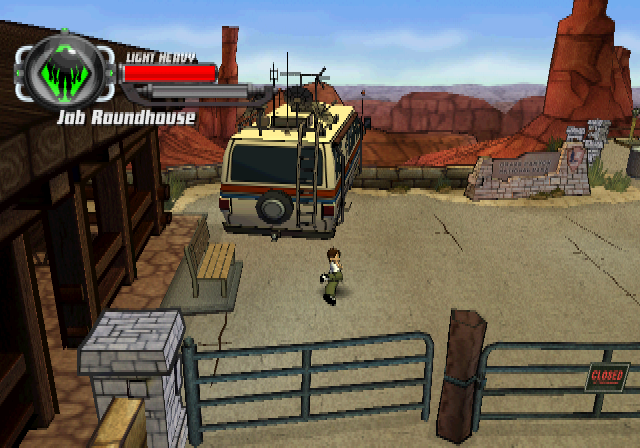

# 20: VU1 census, an offline VU1 replay, a faster VU interpreter, the GS on its own thread

Continues [19](19-windows-build-and-speed.md) s.8-10: in the first level the
VU1 interpreter was the largest cost, then the software GS renderer.

## 1. Which VU programs run in the first level

How: gdb breakpoints on `VU1Interpreter::execute` (VIF `MSCAL` and VU0
`VCALLMS` both end there) and `VU1Interpreter::resume` (VIF `MSCNT`),
printing the unit (`m_unit`), the start PC and the interpreter's cycle
counter, for about 20 seconds in the level. The cycles of a run are the
difference to the next start on the same unit.

- **VU0** (unit 0): about 17,000 calls, almost all at `0x38` and `0x140`,
  plus `0x0`: the skinning microprograms of [18](18-memory-card-and-menus.md)
  s.12, called by `VCALLMS`. The VU0 instance's cycle counter does not move
  between calls (it is reset at every call, s.12), so their cost is not in the table below; the
  stack samples put about 7 of 60 in them.
- **VU1** (unit 1): the work is in **resumed** programs (`MSCNT`). The
  `MSCAL` starts (`0x100`, `0x190`, `0x150`...) run 13 to 45 cycles each:
  set-up code that stops with the E bit; `MSCNT` then continues the
  rendering loops.

| VU1 resume PC | Runs | Share of VU1 cycles | Cycles per run |
|---|---|---|---|
| `0x2DF8` | 432 | 28.8% | 2,815 |
| `0x3BD0` | 261 | 16.3% | 2,639 |
| `0x0BF8` | 285 | 15.2% | 2,258 |
| `0x1038` | 215 | 10.9% | 2,141 |
| `0x3520` | 288 | 7.7% | 1,129 |
| `0x37B0` | 245 | 7.2% | 1,248 |
| 6 others | 305 | 13.9% | 1,264-2,857 |

- **Which code:** a dump of VU1 micro memory in the level matches the
  `.vutext` overlay entries **#13 to #20** ([11](11-vu-microprograms.md),
  group F), each 0x800 bytes at VMA 0x0, 0x800 ... 0x3800 (256 of 257 pairs
  match per entry; the extra pair is the VIF code around the upload). So
  the level's 3D drawing is group F, and the hot entry points above are
  inside it.
- **Uploads:** the decoded-instruction cache was rebuilt 217 times for VU1
  and 63 times for VU0 in 15 seconds (`rebuildDecodedCodeCache`): the game
  uploads microcode (VIF `MPG`) several times per frame.

## 2. An offline replay of VU1 work

To work on VU1 without the game, `tools/vu1_replay/capture_vu1.gdb` saves,
at a VU1 `MSCNT`, the code memory, the data memory and the interpreter's
`VU1State`; `ben10_vu1_replay` (built from `tools/vu1_replay/`) runs them
again through PS2Recomp's interpreter. With `--sum` it prints a checksum per
workload of every result (registers, flags, cycle count, VU data memory, GS
memory). Captures stay in `user/` (they are the game's code and data).

At every one of the 40 resumes captured, the interpreter's pipelines were
empty (`pipelinesPending() == 0`), so code, data and `VU1State` are the
whole starting state.

## 3. A faster VU interpreter (patch 0013)

`callgrind` on the replay (instruction counts do not depend on the
machine's load) showed the time in the bookkeeping more than in the
arithmetic: the pipeline commit pass on every cycle, the hazard check, the
copy of the decoded pair, `markPairWrites`, an out-of-line operand
normaliser. Patch 0013 changes those without changing what is computed:

| Step | Instructions for the 40 workloads |
|---|---|
| before the patch | 296.5 M |
| skip the commit pass until something is due; fast XGKICK drain (findings/19 s.9) | about the same (the scan came back as a recomputation) |
| earliest-ready found in the commit pass itself; decoded pair by reference | 256.7 M |
| hazard check and `markPairWrites` visit only the set VI bits | 234.0 M |
| commit pass visits only valid slots (one bit mask per pipeline array) | 221.1 M |
| `normalizeOperand` inline | 200.1 M |
| `run()` and the hazard check use bit scans for VI and lanes | 185.1 M |

About 36 M of the remaining instructions are the replay's own start-up and
decoding (the replay has no `PS2Memory`, so it does not use the decoded
cache); the VU work itself went from about 260 M to about 150 M. Every
step was checked: the 40 checksums are identical to those of the
interpreter before the patch.

The patch also decodes lazily after a code upload: the cache forgets its
pairs and decodes each one on first use, instead of decoding all 2,048 at
every upload (s.1: several uploads per frame). A pair's decoding reads
only its own 8 bytes, so this cannot change a result.

All 451 ps2xTest cases pass.

In the game (Linux, first level, the same route, about 85 s measured):

| Build | Game frames per second | VBlanks per second |
|---|---|---|
| before patch 0013 | 1.42 | 2.85 |
| patch 0013, first part (findings/19 s.9) | 2.03 | 4.05 |
| patch 0013, complete | 2.58 | 5.17 |

## 4. The GS rasteriser on its own thread

PS2Recomp's GS frontend draws through a replaceable backend
(`GS::setRasterBackend`). `src/gs/gs_async_backend.cpp` installs one that
wraps the CPU rasteriser (`GSCpuBackend`) and runs it on a thread of its
own: primitives, CLUT loads, image uploads and TEXFLUSH are queued (with
their data copied) and run in order by one worker; every call that reads
GS memory for the game (local-to-host transfers, `ReadVram`, snapshots) or
returns a result waits for the queue first. The GS memory after the same
commands is the same bytes. Details in the file's header.

Two problems found on the way, both fixed:

- **Unbounded queue.** The first version let the game run ahead without a
  limit; whenever drawing was the slower side the queue grew (the
  process's memory grew by about 100 MB every 5 seconds). Now the game may
  run at most 8,192 commands ahead (`kMaxPending`) and waits otherwise.
- **Lost key presses.** The window thread called `Sync(Presentation)` and
  `Present`, which first waited for the queue; sampled with gdb, it spent
  nearly all its time there, its loop got slower than a key press, and
  presses were missed (the menus did not react to a 1.2 s press, and
  barely to a 2.5 s one). Presentation does not need to wait: the CPU
  rasteriser copies the frame under its own lock, between two commands,
  as it did when the game thread drew. The picture shown can be a little
  behind the game; the game's own view of GS memory is not.

`BEN10_GS_SYNC=1` keeps the original synchronous backend, for comparisons.

Measurements: s.5.

## 5. Measurements

Linux, game code at `-O0` (runtime and IOP at `-O2`), under Xvfb; the same
route each time (start, New Game, Normal, first slot, the loading tip, the
first level); `BEN10_FPS_LOG` averages. Boot = the warning, intro and
title screens, 20 to 150 s after start; level = about 80 s after arriving.

| Build | Boot, game frames/s | Level, game frames/s | Level, VBlanks/s |
|---|---|---|---|
| before patch 0013 (findings/19 s.9) | 6-7 | 1.42 | 2.85 |
| patch 0013, GS synchronous (`BEN10_GS_SYNC=1`) | 6.81 | 2.76 | 5.53 |
| patch 0013, GS on its own thread | 8.60 | 4.13 | 8.27 |

In the level the game draws one frame every two VBlanks (it runs at 30
frames per second on the console), so 4.13 frames per second is about 14%
of full speed. The picture in the level is unchanged (screenshot compared
by eye with findings/18's).

The scripted route needed longer key holds (2.5 s instead of 1.2 s) while
the window thread still waited for the queue (s.4); with that fixed, the
route works with both backends.

## 6. Where the time goes with the GS thread

40 gdb samples of all threads in the first level (GS thread on):

| Thread | Busy samples | In |
|---|---|---|
| game thread | 36 of 40 | VU1 interpreter 28 (VIF1 kicks 18), VU0 skinning 7, IOP 6, the game's own code 16; waiting for room in the GS queue 4 |
| GS thread | 39 of 40 | `GSCpuBackend` (drawing) |

Both threads are nearly full; the GS thread slightly more. On this
machine (2 cores) there is no third core to give drawing; on a desktop
with more cores there is.

## 7. Row bands: drawing one picture on several threads

- Patch 0014 lets a `GSCpuBackend` draw only some rows of the picture
  (`SetRowBand`: rows y with `((y >> 4) % N) == k`). Several backends on
  the same GS memory that see the same commands in the same order write
  the same bytes as one (each pixel is drawn by exactly one band). A
  ps2xTest case draws blended, Z-tested triangles and a textured sprite
  with two bands, one after the other (the worst order), and gets the
  same frame and Z buffer as one backend.
- `src/gs/gs_async_backend.cpp` uses it with `BEN10_GS_THREADS=N`: the GS
  thread becomes a dispatcher that hands runs of draws, CLUT loads and
  TEXFLUSHes ("segments") to N bands (band 0 on the dispatcher itself)
  and waits for all of them before a transfer. A band must never read GS
  memory another band is still writing: the dispatcher tracks the 8 KB
  pages written in the current segment (frame and Z rows inside the
  scissor, over-estimated) and ends the segment before a draw whose
  texture pages, or a CLUT load whose CLUT page, are among them.
- The one difference left with N > 1: each band has its own copy of the
  GS texture page buffer, so stale texture data seen without a TEXFLUSH
  can differ. Games must TEXFLUSH after rendering to a texture.
- Default N = 1 (one GS thread, as in s.4): this machine has 2 cores, so
  the bands could not be measured for speed. Checked here: with N = 2 the
  game runs the same route into the first level, the picture looks the
  same, and the level runs at the same rate as with one band (about 4
  frames per second: no spare core).

## 8. The frame wait loop (src/overrides/draw_wait.cpp)

- In the samples of s.6 the game thread was often in the IOP interpreter
  called from `entry_0012e590`: the loop of `FUN_0012e580`, which spins
  until the VIF1 DMA end handler clears bit 0x10 of the flags at
  `0x00268548` or ten VBlanks pass (disassembly: `lw`/`andi`/`beqz`,
  `lw`/`slt`/`bnez`). Each turn counts 32 EE cycles at a checkpoint, and
  each checkpoint steps the IOP by 32 cycles. While the game waits, the
  PS2's clock, which brings the next interrupts, moves in 32-cycle steps,
  each paying the checkpoint's fixed cost.
- The override runs the same loop natively and counts 1024 cycles per
  turn: the loop only reads two words, so nothing on the EE side changes
  between turns; the interrupts that end it are taken at most 1024 cycles
  (3.5 microseconds of PS2 time) after they are due, instead of 32. EE
  timer interrupts inside a step are taken at its end.
  `BEN10_DRAW_WAIT_STEP=32` gives back the original step.
- Result (same route, GS thread on, one band): first level 4.13 -> 4.41
  game frames per second, boot screens 8.60 -> 9.03. Small here, because
  the GS thread is the limit on this 2-core machine (s.6); it matters more
  once drawing has more cores.
- Ben still walks in the level (W). Observed, not investigated: pressing
  Cross (X) in the level opened the pause menu ("Game Paused", with
  "Drop Player One"); also seen once before this change.

## 9. Face buttons opened the co-op pause menu (patch 0015)

- Symptom (s.8): in the first level every face button (Square, Triangle,
  Circle, Cross) opened "Game Paused" with "Drop Player One", and the next
  press closed it; the HUD (health bar, Omnitrix) sat at the top right.
- Cause: the runtime's pad code gave every opened port the same input
  (the keyboard and the first host gamepad) and reported every opened
  port STABLE. The game opens port 1 too, so it saw a second player whose
  buttons were pressed with player 1's: player 2 "joined" and the co-op
  menu came up. `PSPadBackend::readState` and the keyboard fallback in
  `readPadPortData` ignore the port.
- Fix (patch 0015): only port 0, slot 0 has a controller; for any other
  port/slot `scePadGetState` reports DISCONNECTED and `scePadRead` reads
  nothing. New ps2xTest case; 453/453 pass.
- Result: in the level, Square and Triangle now attack (the HUD names
  the combo, "Light", "Jab Roundhouse"), Cross jumps, and the HUD moved
  to the top left, the one-player layout (screenshot 09).
- A second player (a second host gamepad in port 1) is future work.

*Captured from this port (Linux). The picture shows the content of Ben 10:
Protector of Earth (High Voltage Software / D3 Publisher; Ben 10 is a
trademark of Cartoon Network); it is not the work of this project. See
[the screenshots README](../images/screenshots/README.md).*

## 10. Playing further in the first level

About ten minutes of play after patch 0015 (Linux, about 4 frames per
second, keyboard), no stop and no `missing-target` in the log:

- The Omnitrix works: Right Shift (R2) picks an alien on the dial, E (R1)
  transforms; Ben became Heatblast, drawn correctly (skinned model, fire
  effect).
- Walking on triggers the game's tutorial pop-ups ("Omnitrix
  Activation", "Combat"), closed with Cross.
- The first enemies appear with their introduction card ("Vilgax Drone",
  with toughness, strength, ranged, melee and speed bars); the fight
  works: Square/Triangle combos ("Rising Heat"), the combo counter, the
  drones attacking back. A "Loading" mark shows while the level streams
  more data.

*Captured from this port (Linux). The picture shows the content of Ben 10:
Protector of Earth (High Voltage Software / D3 Publisher; Ben 10 is a
trademark of Cartoon Network); it is not the work of this project. See
[the screenshots README](../images/screenshots/README.md).*

## 11. A palette cache for indexed textures (patch 0016)

- **Where the GS thread's time goes.** 60 gdb samples of the GS thread in
  the level: `SampleTexture` in 28 (the CLUT lookup 7, the swizzled
  address calculation 8, the texture page buffer's copy 3, `lroundf` of
  the bilinear blend 2), the rest of `DrawTriangle` in 37 (samples count
  once per frame they appear in).
- **The change (patch 0016).** Every T8/T4 texel, four per pixel with
  bilinear filtering, went through `LookupCLUT`: the CLUT index from CSA,
  CSM and the source format, the CLUT read, then the TEXA alpha rules.
  `SampleTexture` now keeps the final colour per source index in a
  256-entry table filled on first use. The table's key packs every input
  of `LookupCLUT` except the index and the CLUT itself (CPSM, CSM, CSA,
  4-bit or 8-bit source, TA0, AEM, TA1); every CLUT write sets the key to
  a value no draw state packs to. A hit returns exactly what `LookupCLUT`
  would. A new ps2xTest case reloads the CLUT and changes TEXA between
  draws (it fails if the CLUT load does not reset the key); 454/454 pass.
- **Tried and dropped:** replacing `std::lround` in the bilinear blend by
  an inline exact rounding made the same draw loop 20% slower than libm's
  `lroundf` here.
- **Measured.** A throw-away timing loop in ps2xTest (100 full-screen
  T8 triangles, CT16 CLUT, bilinear): 3.47 s before, 3.30 s after (-5%).
  In the game the frame rate of this cloud machine moved by up to 20%
  between two runs of the same binary (2.97 and 3.55 frames per second,
  first level, same route), so it cannot show a 5% change. CPU time per
  game frame of each thread (from `/proc`, 90 s in the level, with
  `tools/perf/cpu_per_frame.sh`):

  | Thread | Before | After (two runs) |
  |---|---|---|
  | GS thread | 306 ms | 274 ms, 285 ms |
  | game thread | 219 ms | 197 ms, 213 ms |
  | Mesa llvmpipe (presenting through Xvfb, 2 threads) | 64 ms | 54 ms, 54 ms |
  | main (window) thread | 24 ms | 21 ms, 22 ms |

  The four add up to about two cores' worth per frame: on this 2-core
  machine every thread's CPU time counts, including software OpenGL for
  the window, which a real GPU does instead.

## 12. Why the VU0 cycle counter does not move (s.1)

- Code: `PS2Runtime::executeVU0Microprogram` (`VCALLMS`/`VCALLMSR`) calls
  `m_vu0.reset()` before every call, which sets the interpreter's cycle
  counter to 0, then copies the EE's VU0 registers in, runs the program
  with a budget of 4,096 cycles and copies the registers back. So each
  call counts from 0: nothing is wrong with the counter, and nothing
  carries timing from one `VCALLMS` to the next.
- Is the 4,096-cycle budget ever reached? A gdb breakpoint after the run,
  30 s in the first level: 2,576 calls, all ended by the program (E bit)
  well inside the budget: 1,288 at `0x38` and 1,272 at `0x140`, 34 cycles
  each, and 16 at `0x0`, 7 cycles. No call is cut short.
- Left as it is: re-entering the VU0 program with no pipeline state is
  what the hardware does after a program has ended (KNOWN_ISSUES R22 is
  about VU0 running alongside the EE, not about this).

## 13. Playing further: scripted input is not enough

A 20-minute scripted session (Cross, W held 12 s, attacks, D, W again,
repeated) after reaching the first level moved Ben about one screen: at
3 frames per second a 12-second key hold is about one second of game time,
and the fixed pattern ended against the wall by the park sign. No stop,
no `missing-target`, no error in the log. Playing past the first fight
needs either more speed or input chosen by looking at each picture.

## 14. Where the VU interpreter's time goes, and what group F reads (input for D14)

**Profile.** `callgrind` of `ben10_vu1_replay --reps 10` (40 workloads,
1.11 million VU cycles), instructions in the VU code only:

| Part | Functions | Instructions |
|---|---|---|
| Pipeline bookkeeping | `commitReadyPipelines` 181M, `calculatePairReadyCycle` 128M, `markPairWrites` 104M, `queueVfWrite` 51M | 464M |
| FMAC result and flag model | `calculateFmacExactResult` 108M, `updateFmacFlags` 62M, `normalizeFmacResult` 50M, `normalizeFmacExactResult` 37M, `calculateFmacProductSticky` 34M | 291M |
| The operations | `execUpper` 144M, `execLower` 61M | 205M |
| The pair loop | `run` 167M, `getDecodedInstructionPairForPc` 48M | 215M |
| Decoding | `decodeInstructionPair`, `decodeLowerUsage`, `decodeUpperUsage` | 141M |

About 1,200 host instructions per VU cycle. The decoding line is mostly an
artefact of the replay: it passes no `PS2Memory`, so the interpreter
decodes every pair at every step; in the game the decoded pairs are kept
until the next code upload. Without it, the VU code takes 1,175M
instructions; the shares below are of that.

**What group F reads.** The VU1 code memory captured in the level (group
F, 2,048 instruction pairs) counted with `tools/analyzer/vu_disasm.py`:

- 769 of the 2,048 upper instructions and 509 lower ones are NOPs;
  the lower side is mostly loads and stores (384 `LQ`, 139 `SQ`, 28 `LQI`,
  27 `SQI`, 61 `ILW`, 58 `ISW`) and integer work for addresses and loops.
- Flag reads: 21 `FMAND` and 3 `FMEQ` (MAC flags), 20 `FCGET` and 12
  `FCAND` (clipping flags, written by 20 `CLIPw`). No status-flag read
  (`FSAND`, `FSEQ`, `FSOR`) and no `FSSET`.
- FDIV: 43 `DIV`, 4 `RSQRT`, 14 `WAITQ`. No EFU instruction (no `E...`,
  `MFP` or `WAITP`). 12 `XGKICK`.

**What this means for the native VU1 (D14).**

- A translation that keeps the interpreter's model (phase 1) saves the
  pair loop (18%) and the dispatch inside `execUpper`/`execLower` (part
  of their 17%): at most about a third.
- The bookkeeping (about 40%) goes away only where the translator works
  out the timing at translation time (phase 2): the pipelines are empty at
  every resume (s.2), so each block's timing can be computed from its
  entry.
- The flag model (about 25%) is needed only for results whose MAC flags
  can reach one of the 24 MAC-flag reads before the next FMAC instruction
  replaces them; the status flags are never read inside group F. Whether
  the EE reads VU1's status register was not checked; the replay's checksum
  includes it, so a translation that stops computing it needs that
  checksum changed on purpose, with the reason written down. The
  exact-result part also decides overflow and underflow values, so only
  the flag half can go.

## 15. Longer IOP steps: tried, not kept

- **Idea.** The scheduler gives the IOP the EE's elapsed time at every
  checkpoint: 32 EE cycles, 4 IOP cycles. Each IOP step services DMA
  interrupts, callbacks and timers and switches into a thread and out
  again, for 4 cycles of work. A runtime change (`EeScheduler::setIopStepCycles`,
  default unchanged) collected the cycles and handed them over in steps
  of at least 256 EE cycles; a ps2xTest case checked that the IOP still
  got every cycle.
- **Measured** (first level, same route): game thread 221 ms of CPU per
  game frame with the old step, 211 ms with 256: inside the spread of
  repeated runs of one binary (197-221 ms, s.11).
- **Why so little.** 50 gdb samples of the game thread in the level with
  the old step: VU1 interpreter 28, waiting for room in the GS queue 16,
  other 6, the IOP 0. Since the frame wait loop runs natively (s.8), the
  IOP no longer shows in the level; and on this 2-core machine the game
  thread spends a third of its time waiting for the GS thread.
- Not kept: a timing change with no measured gain. The patch and the
  override were removed before committing; this section is the record.

## 16. Open

- Measure `BEN10_GS_THREADS` = 2, 4, 6 on a desktop with more cores; make
  the best one the default.
- Native VU1 (decision D14): translate group F and the VU0 skinning
  programs; `ben10_vu1_replay` is the reference.
